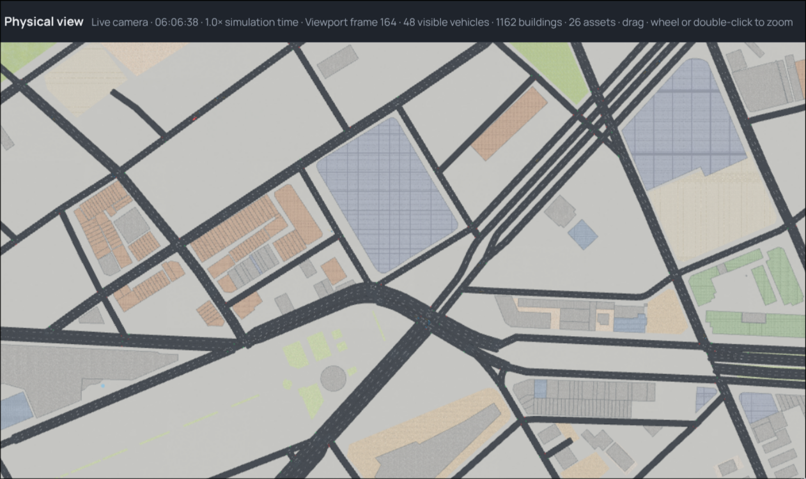

<div align="center">

<h1>Traffic Event System</h1>

<p><strong>District-scale traffic simulation, routing, and visualization for Ho Chi Minh City</strong></p>

<p>
  
  
  
  
  
</p>

<p>
  <a href="#application-preview">Application Preview</a> ·
  <a href="#requirements-coverage">Requirements</a> ·
  <a href="#run-the-application">Quick Start</a> ·
  <a href="#architecture-and-object-oriented-design">Architecture</a> ·
  <a href="#project-documentation">Documentation</a>
</p>

</div>

Traffic Event System is a completed object-oriented programming (OOP) group project. The application models a directed road network, advances multiple vehicles through a microscopic simulation, reacts to traffic events, and compares routing algorithms under repeatable scenarios.

The Java backend owns the simulation state, routing, traffic events, demand, and statistics. A React dashboard presents network traffic on a Leaflet map and lane-level movement in a PixiJS physical view. The default scenario uses stored OpenStreetMap data for the former District 1 area of Ho Chi Minh City.

## Application preview

<p align="center">
  
</p>

<p align="center"><sub>Lane-level physical simulation with District 1 road geometry</sub></p>

## Features

The simulator combines the required network, vehicle, routing, event, visualization, and analysis systems:

- Directed road graphs with lane geometry, junction movements, traffic signals, network editing, and JavaScript Object Notation (JSON) or comma-separated values (CSV) import
- Breadth-First Search (BFS), Dijkstra, and A* routing with distance, time, and congestion-aware costs
- Cars, motorcycles, buses, and emergency vehicles with lane occupancy, car-following, lane changes, stops, and priority rules
- Congestion, accidents, breakdowns, and road closures with dynamic route recalculation
- Seeded demand, multi-leg trips, dwell times, boundary traffic, and deterministic playback
- Live statistics, route comparison, frame history, traffic-flow traces, and reproducible algorithm experiments

## Requirements coverage

The implementation covers the functional, object-oriented, visualization, and analysis requirements in the project specification.

| Project requirement | Implementation | Evidence |
|---|---|---|
| Road network | Directed graph operations, road conditions, JSON/CSV loading, export, and synthetic maps | [Architecture](docs/ARCHITECTURE.md) |
| Vehicle simulation | Multiple vehicle types, independent routes, lane movement, travel history, and arrival handling | [Vehicle flow](docs/VEHICLE_FLOW.md) |
| Routing and navigation | BFS, Dijkstra, A*, three route objectives, and dynamic route recalculation | [Routing algorithms](docs/ALGORITHM_EXPLANATION.md) |
| Traffic events | Congestion, accidents, breakdowns, closures, traffic signals, and event processing | [Application programming interface (API) contract](docs/API_CONTRACT.md) |
| Simulation engine | Time steps, pause, resume, reset, speed control, event handling, replay, and statistics | [Live demo guide](docs/DEMO_GUIDE.md) |
| Visualization | Road graph, vehicle movement, route paths, congestion indicators, and statistics panels | [Application preview](#application-preview) |
| Statistics and experiments | Travel, routing, density, recalculation, optimality, and scenario comparisons | [Experiment results](docs/EXPERIMENT_RESULTS.md) |
| OOP and design patterns | Encapsulation, inheritance, polymorphism, abstraction, Strategy, Observer, and Factory | [Class diagram](docs/CLASS_DIAGRAM.md) |

## Technology stack

The project uses one Java backend and one browser frontend:

- **Backend**: Java 17, Maven, Javalin, Jackson, and Apache Commons CSV
- **Frontend**: React 19, Vite, React Leaflet, Leaflet, and PixiJS
- **Testing**: JUnit 5, AssertJ, Vitest, Testing Library, and ESLint
- **Data**: OpenStreetMap road geometry, local scenarios, and configurable demand parameters

## Run the application

### Prerequisites

Install these tools before running the project:

- Java Development Kit (JDK) 17 or newer
- Apache Maven 3.9 or newer
- Node.js 20.19+ within Node 20, or Node.js 22.12+
- npm

### Clone and launch

Clone the repository and enter its root directory:

```bash
git clone <repository-url>
cd Traffic-Event-System
```

On Linux or macOS, run:

```bash
./run-demo.sh
```

On Windows PowerShell, run:

```powershell
.\run-demo.ps1
```

The scripts install locked frontend dependencies, build the dashboard, package it inside the application Java archive (JAR), and start the server. Open [Traffic Event System at localhost](http://localhost:7070).

Run `./run-demo.sh --help` on Linux or macOS to see options for ports, scenarios, and build reuse. On Windows, run `Get-Help .\run-demo.ps1 -Detailed`. Launch the JAR from the repository root because the Java process reads runtime files from `data/`.

The simulation, routing, events, and vehicle positions run locally. Leaflet needs internet access to request OpenStreetMap basemap tiles.

### Explore the simulator

Use this short walkthrough after the dashboard opens:

1. Start or pause playback and select a simulation pace.
2. Inspect traffic pressure, vehicles, routes, and incidents on the macro map.
3. Compare BFS, Dijkstra, and A* in the **Route lab**.
4. Add a vehicle or schedule an incident from the control panels.
5. Open **Physical view** to inspect lane-level movement and signals.
6. Review live statistics, frame history, and the reproducible experiments.

See the [live demo guide](docs/DEMO_GUIDE.md) for the presentation walkthrough and troubleshooting steps.

## Development

Run the backend and frontend in separate terminals for live frontend updates.

Backend:

```bash
mvn compile exec:java
```

Frontend:

```bash
cd frontend
npm ci
npm run dev
```

Vite prints the development URL and proxies `/api` requests to `http://localhost:7070`.

### Build the application JAR

Build the dashboard and executable JAR from the repository root:

```bash
npm --prefix frontend ci
npm --prefix frontend run build
mvn clean package
java -jar target/traffic-event-system-1.0-SNAPSHOT.jar
```

## Architecture and object-oriented design

The application separates domain rules, routing, simulation, services, persistence, and visualization.

| Layer | Responsibility |
|---|---|
| Domain | Road network, vehicles, events, demand, signals, and statistics |
| Routing | BFS, Dijkstra, A*, route costs, and adaptive navigation |
| Simulation | Clock, ticks, vehicle dynamics, demand spawning, event processing, and replay |
| Services and API | Application use cases, Javalin controllers, Representational State Transfer (REST) endpoints, and Server-Sent Events (SSE) streaming |
| Frontend | React controls, Leaflet macro map, PixiJS physical view, and experiment charts |
| Persistence | JSON/CSV maps, scenarios, demand parameters, exports, and synthetic maps |

The main OOP requirements map to implemented code:

| Principle or pattern | Implementation |
|---|---|
| Encapsulation | Domain objects validate and manage their state |
| Inheritance | `Vehicle` and `TrafficEvent` define shared abstract behavior |
| Polymorphism | Routing strategies and vehicle or event subclasses share abstractions |
| Abstraction | Controllers use service interfaces; routing uses `PathFindingStrategy` |
| Strategy | Routing, car-following, lane-changing, and demand policies |
| Observer | `TrafficEventBus`, `TrafficEventListener`, and simulation snapshot listeners |
| Factory | `VehicleFactory` creates each supported vehicle type |

See the [component-level architecture](docs/ARCHITECTURE.md) and [implemented class diagram](docs/CLASS_DIAGRAM.md) for the complete design.

## Configuration

Configure the backend at runtime and the frontend at build time:

| Variable | Default | Purpose |
|---|---|---|
| `PORT` | `7070` | Backend HTTP port |
| `SCENARIO_FILE` | `data/scenarios/district1_typical_day.json` | Scenario loaded at startup |
| `MAP_FILE` | unset | Topology-only map override when `SCENARIO_FILE` is unset |
| `VITE_API_BASE_URL` | `/api` | Frontend API base URL |
| `VITE_TILE_URL` | OpenStreetMap | Map tile URL template |
| `VITE_TILE_ATTRIBUTION` | OpenStreetMap attribution | Map attribution text |

See [`frontend/.env.example`](frontend/.env.example) for the frontend defaults.

## Project structure

The repository keeps runtime code, tests, documentation, and scenario data in separate top-level directories:

```text
.
├── data/                    Maps, demand parameters, scenarios, and results
├── docs/                    Architecture, API, algorithms, and design notes
├── frontend/                React dashboard and physical-view renderer
├── src/main/java/           Java application source
├── src/test/                Backend tests and test maps
├── pom.xml                  Maven build
├── run-demo.sh              Linux and macOS launcher
└── run-demo.ps1             Windows launcher
```

## Scenarios and data

The Java server loads [`district1_typical_day.json`](data/scenarios/district1_typical_day.json) at startup. This seeded 24-hour scenario uses the District 1 network and configurable demand assumptions.

| File | Contents |
|---|---|
| [`data/maps/district1_network.json`](data/maps/district1_network.json) | Intersections, directed roads, buildings, and land cover |
| [`data/demand/default_assumptions.json`](data/demand/default_assumptions.json) | Demand curves, vehicle mix, occupancy, and attraction parameters |
| [`data/scenarios/district1_typical_day.json`](data/scenarios/district1_typical_day.json) | Default simulation scenario |
| [`data/results/experiment_results.json`](data/results/experiment_results.json) | Checked-in routing experiment results |

The scenario is an educational model, not a calibrated traffic forecast. The [District 1 scenario report](docs/DISTRICT1_SCENARIO.md) records the sources, assumptions, sampling method, and limitations.

OpenStreetMap contributors supply the road geometry. The repository stores a copy under `data/` for simulation runs. The map data remains licensed under the [Open Data Commons Open Database License](https://opendatacommons.org/licenses/odbl/).

## Testing

The repository includes backend and frontend checks. Run the backend test suite:

```bash
mvn test
```

Run the frontend checks:

```bash
cd frontend
npm test
npm run lint
npm run build
```

## Routing experiments

The experiment runner compares BFS, Dijkstra, and A* under normal traffic, heavy congestion, random events, and a synthetic 20 × 20 network.

```bash
mvn -q exec:java -Dexec.mainClass=team.traffic.experiment.ExperimentRunner
```

Add `-Dexec.args=--write` to update the checked-in JSON and Markdown reports. The [experiment results](docs/EXPERIMENT_RESULTS.md) record the current baseline.

## Project documentation

The repository includes each documentation deliverable from the project specification:

- [Architecture](docs/ARCHITECTURE.md)
- [API contract](docs/API_CONTRACT.md)
- [Class diagram](docs/CLASS_DIAGRAM.md)
- [Routing algorithm explanation](docs/ALGORITHM_EXPLANATION.md)
- [Vehicle flow](docs/VEHICLE_FLOW.md)
- [District 1 scenario and data sources](docs/DISTRICT1_SCENARIO.md)
- [Experiment summary](docs/EXPERIMENT_RESULTS.md)
- [Live demonstration guide](docs/DEMO_GUIDE.md)

## License

The team licenses the software under the [MIT License](LICENSE). OpenStreetMap-derived data remains subject to the [Open Data Commons Open Database License](https://opendatacommons.org/licenses/odbl/).
