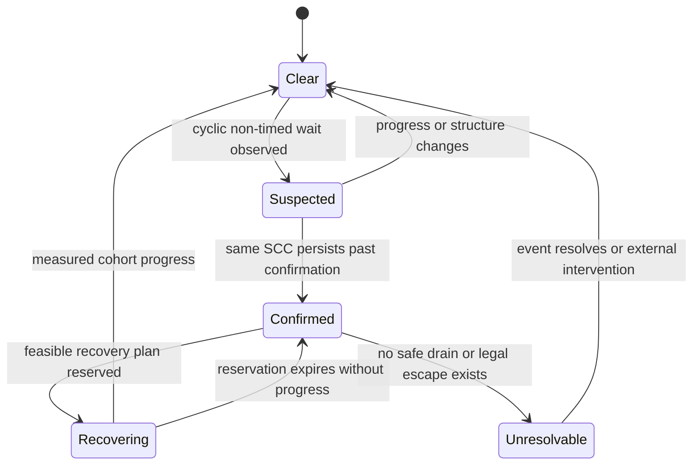

# Adaptive navigation, driver awareness, U-turn, and deadlock design

**Status:** implemented, merged, and enabled by default in the production
composition root.

The implementation preserves the disabled-mode compatibility path while the
application enables adaptive traffic by default. Engineering defaults remain
uncalibrated assumptions, as noted in the configuration section.

### Implementation map

- Route anchors, route versions, atomic suffix splicing, immutable perception,
  motion outcomes, cause-local waiting, driver knowledge, deterministic
  information delivery, adaptive batching/caching/backoff, and edge-state
  routing are implemented in their packages described below.
- `JunctionMovementGraph` is authoritative for routing, vehicle execution,
  editor/loader validation, and lane-connector geometry. Explicit rules persist
  as `junctionMovements`. Explicit mid-block points load from
  `turnaroundPoints` and normalize into a synthetic junction plus split roads.
- Deadlock monitoring uses a bipartite wait-for graph, deterministic Tarjan
  SCCs, stable-fingerprint confirmation, timed-wait exclusions, region gates,
  and strict physical drain reservations. Assisted recovery stays disabled and
  has no silent relocation/despawn implementation.
- Scenario/API initialization accepts `adaptiveTraffic`, `driverProfiles`, and
  event publication metadata. `/api/simulation/diagnostics` exposes navigation,
  information, deadlock, reservation, and active-cycle evidence; vehicle
  snapshots expose cause-local and navigation diagnostics.
- Each strategic routing snapshot is masked through that vehicle's
  `DriverKnowledge`: unknown authoritative event delay, congestion, and
  fullness cannot affect its choice. Decision records retain old/new route and
  cost fingerprints, knowledge version, reason, outcome, and decision time.
- The selected-vehicle frontend inspector surfaces the same wait/navigation
  evidence carried by live and historical SSE frames. Completed vehicles keep
  their cause-specific waiting totals in aggregate diagnostics.

### Verification

- The current backend and frontend regression suites, ESLint and production
  Vite build are the acceptance gates; run the commands in `README.md` rather
  than relying on a hard-coded test count that changes with later work.
- Routing computation count, cache hit rate, and mean compute time are recorded
  at runtime instead of assigning an unprofiled absolute millisecond budget.

This design adds five cooperating capabilities to the microscopic simulation:

1. local perception of leaders, signals, lane obstructions, and downstream space;
2. imperfect navigation information about events and congestion ahead;
3. driver-specific decisions about waiting, rerouting, and accepting a U-turn;
4. location- and manoeuvre-aware route replacement; and
5. deterministic detection and recovery of genuine traffic deadlocks.

The feature is deliberately independent of trip purpose. A vehicle produced by
`HOME_TO_WORK`, `DELIVERY`, an OD matrix, a scripted scenario, or the manual
spawn API enters the same perception and navigation pipeline. Demand decides
*why and when a trip exists*; this design decides *how its driver reacts while
executing it*.

## Decisions first

- Safety-critical movement remains local and runs every physical sub-step.
  Strategic navigation runs at a slower cadence and never overrides car-following,
  lane-change safety, signal, junction, or road-admission checks.
- A driver does not read `RoadNetwork` or the event list as omniscient truth.
  The simulation owns truth; a persistent `DriverKnowledge` contains only
  observations and notices that have reached that driver.
- `DriverProfile` owns a nested `DriverDecisionProfile`. It controls information
  delay/horizon, patience, reroute hysteresis, and U-turn willingness. It does
  not grant a manoeuvre that the network says is illegal or physically unsafe.
- Rerouting is coordinated outside `Vehicle`. `Vehicle` owns its position and
  accepts an already-validated route suffix atomically.
- Routing state is `(incoming road, junction)`, not only `junction`. This is
  required to represent turn restrictions and legal U-turns.
- A U-turn is a legal network manoeuvre at an explicit junction or normalized
  turnaround point. It is not an ordinary lane change, reverse driving, an
  arbitrary crossing of the median, or a teleport.
- A stationary timeout requests a new decision even when the vehicle has not
  reached another junction. It cannot manufacture a physically reachable exit.
  If every lane ahead is sealed before the next legal manoeuvre, strict physics
  has no route-based solution.
- Deadlock recovery first prevents more traffic entering the affected region,
  then reserves a real drain path. It never grants entry into occupied space.
  A completely saturated closed cycle with no legal exit is reported as
  unresolvable unless an explicit demo-only assisted-recovery policy is enabled.
- All thresholds use simulated seconds or metres, never UI playback speed,
  logical tick count, or accumulated whole-trip waiting ticks.
- Decisions, tie-breaks, and information reception remain reproducible for the
  same scenario seed and vehicle ids.

## Pre-implementation baseline

These were verified properties before this implementation and explain the
changes below.

| Area | Pre-implementation behavior | Consequence |
|---|---|---|
| Local traffic | `TrafficState`, `RoadOccupancy`, and `Lane` can find leaders and active lane obstructions; signal state is available only through junction clearance | Useful facts exist, but there is no single perception snapshot and no explicit reason why a vehicle waited |
| Dynamic information | `DynamicReroutingListener` receives every active event and immediately reroutes every vehicle whose remaining route contains that road | Every driver is omniscient, equally fast to react, and has no patience, horizon, confidence, or cooldown |
| Driver model | `DriverProfile` contains gaps, reaction time, imperfection, speed factor, turning comfort, politeness, and lateral speed | It models microscopic motion, not information or strategic decisions |
| Route request | `RouteRequest` contains only start intersection, destination intersection, and preference | The router cannot distinguish arriving from different roads, so it cannot enforce movement/turn restrictions |
| Mid-road reroute | `Vehicle.currentIntersectionId` remains the road's start until the road is completed; `RoutePlan.assign` resets progress to step zero | Recomputing while physically on a road is not a safe location-aware suffix replacement |
| Full roads | `Road.isAvailable()` is false at current capacity and routing excludes unavailable roads | Temporary queue storage is treated like a permanent missing edge; this encourages route failure and churn |
| Retry | `TickProcessor` recomputes every `BLOCKED` vehicle after each logical tick | There is no backoff, hysteresis, or distinction between no route and no room *right now* |
| Waiting time | Junction priority receives `TripRecord.waitingTicks`, accumulated across the whole trip | It is not junction-local, cause-local, or invariant under different sub-step durations |
| U-turn | `TurnDirection` can classify `U_TURN`, but the router has no legal-movement graph and physical scene connectors omit the reverse movement | Routing, dynamics, and rendering do not share one authoritative U-turn contract |
| Deadlock | Admission and spillback prevention exist, but there is no wait-for graph, persistent no-progress detector, or recovery coordinator | A queue can remain frozen indefinitely without a diagnosis |

The first implementation phase therefore fixed the route-location and
waiting-reason contracts. Adding only a timeout on top of the former model
would have repeatedly requested a route from the wrong anchor and would not
have distinguished a red light from a structural lock.

## Goals and non-goals

### Goals

- Let a vehicle react locally to its leader, signal, blocked lane, and downstream
  entry space without global knowledge.
- Let navigation-equipped drivers learn about active events and measured
  congestion ahead with driver-specific delay and horizon.
- Replan before reaching the affected intersection when it is beneficial.
- Preserve the current road, exact progress, lane, and lateral motion when a
  route suffix changes.
- Support legal U-turns consistently in routing, junction arbitration, vehicle
  execution, and physical rendering.
- Retry stalled vehicles using cause-aware timers and exponential backoff.
- Detect persistent cyclic waiting without mistaking red signals, dwell, or a
  temporary queue for deadlock.
- Recover a deadlock when a safe drain sequence exists and report when one does
  not.
- Keep experiments deterministic and observable.

### Non-goals

- Drivers do not perform arbitrary reverse driving.
- Lane changes never cross from one directed carriageway to its opposite side.
- The router does not teleport a vehicle to the next intersection.
- The model does not infer legal median openings from visual road width alone.
- A timeout does not guarantee escape from a physically sealed road.
- Navigation does not predict future scenario events that have not been
  announced.
- Deadlock recovery does not silently delete or relocate vehicles.
- The first version does not attempt human-level negotiation or continuous
  trajectory planning inside a junction.

## Safety and consistency invariants

Every implementation and test must preserve these invariants:

1. **One physical truth.** At a sub-step boundary, a vehicle occupies at most one
   directed road and one continuous lateral footprint.
2. **No route teleport.** Replacing a route never changes road placement,
   progress, lane, speed, or visited intersections.
3. **Connected suffix.** Every accepted route suffix starts at the vehicle's
   real next routing anchor and every adjacent road pair is an allowed
   `JunctionMovement`.
4. **Safety wins.** A driver request can ask for a lane change, crossing, or
   U-turn; the microscopic safety and junction models may reject it.
5. **Knowledge is not truth.** Driver decisions read `DriverKnowledge`, while
   road admission and collisions read authoritative simulation state.
6. **No premature event leak.** A scheduled event is unknown until its configured
   publication time or local observation.
7. **No route oscillation.** The same knowledge and cost snapshot cannot cause
   repeated switching between equivalent routes inside the cooldown window.
8. **No false deadlock from a timer.** A known future release such as green
   signal, dwell completion, or event expiry is a timed wait, not a wait-for
   cycle.
9. **Recovery preserves occupancy.** A recovery grant is valid only if the
   complete reserved movement has physical space and no conflicting grant.
10. **Deterministic replay.** Stable ids, simulation time, scenario seed, and
    the same input snapshots produce the same knowledge delivery, route choice,
    and recovery choice regardless of vehicle list order.

## Architecture

```mermaid
flowchart LR
    Events["Event coordinator"] --> Truth["Authoritative network information"]
    State["TrafficState snapshot"] --> Perception["LocalPerceptionService"]
    State --> TravelTimes["RoadTravelTimeEstimator"]
    Truth --> Information["TrafficInformationService"]
    TravelTimes --> Information

    Perception --> Context["DriverContext"]
    Information --> Knowledge["Persistent DriverKnowledge"]
    Knowledge --> Context
    Profile["DriverProfile + DriverDecisionProfile"] --> Context
    Context --> Policy["DriverDecisionPolicy"]

    Policy -->|lane intent| Dynamics["Car following + lane-change safety"]
    Policy -->|reroute request| Coordinator["AdaptiveNavigationCoordinator"]
    Coordinator --> Snapshot["Immutable RoutingSnapshot"]
    Snapshot --> Router["AdaptiveRouter"]
    Router --> Splice["Validated RoutePlan suffix splice"]

    Dynamics --> Outcome["MotionOutcome + WaitState"]
    Outcome --> Stall["Progress/StallTracker"]
    Stall --> Detector["DeadlockDetector"]
    Detector --> Resolver["DeadlockResolver"]
    Resolver --> Gates["Region gates + RecoveryReservation"]
    Gates --> Dynamics

    Movements["JunctionMovementGraph"] --> Router
    Movements --> Dynamics
    Movements --> Scene["Physical connector geometry"]
```



There are two loops:

- the **motion loop** runs every physical sub-step. Normal UI paces keep it at
  most one simulated second; the engine caps pathological API ticks at 60
  sub-steps, so an API tick above 60 seconds exceeds that integration bound;
- the **strategic loop** runs on a configurable cadence, an information delivery,
  a hard-block observation, or a stall deadline.

This separation prevents hundreds of identical route searches while keeping
braking and obstruction avoidance responsive.

## Ownership and package boundaries

| Package | New responsibility | Principal types |
|---|---|---|
| `domain.network` | Legal transitions between directed roads | `JunctionMovement`, `MovementPermission`, `JunctionMovementGraph` |
| `domain.vehicle.dynamics` | Immutable local observations and motion outcomes | `LocalPerception`, `LaneObservation`, `SignalObservation`, `MotionOutcome`, `WaitCause`, `WaitResource` |
| `domain.vehicle.navigation` | Per-driver knowledge and navigation state | `DriverDecisionProfile`, `DriverKnowledge`, `NavigationState`, `StallState`, `UTurnPolicy` |
| `domain.routing` | Location-aware requests and validated candidates | `RouteAnchor`, `AdaptiveRouteRequest`, `RouteCandidate`, `RouteCost` |
| `routing` | Edge-state search and dynamic cost calculation | `AdaptiveRouter`, `RoutingSnapshot`, `RoadTravelTimeEstimator` |
| `simulation.navigation` | Information delivery, decisions, batching, route splicing | `TrafficInformationService`, `DriverDecisionPolicy`, `AdaptiveNavigationCoordinator` |
| `simulation.deadlock` | Persistent wait graph, detection, and recovery directives | `WaitForGraph`, `DeadlockDetector`, `DeadlockResolver`, `RecoveryReservation`, `RegionGate` |

`Vehicle` remains the aggregate that owns `RoadPlacement`, `RoutePlan`, trip
lifecycle, and current navigation state. It does **not** call the router or scan
the global event list. Its new mutation boundary is intentionally small:

```java
vehicle.replaceRemainingRoute(anchor, candidate);
vehicle.recordNavigationDecision(decision);
vehicle.commitMotion(outcome);
```

`AdaptiveNavigationCoordinator` owns orchestration. This prevents `Vehicle`
from becoming a class that simultaneously senses, predicts traffic, searches a
graph, detects global cycles, and moves.

## 1. Local perception

### Contract

`LocalPerceptionService` converts one captured `TrafficState` into immutable
facts visible from one vehicle:

```java
public interface LocalPerceptionService {
    LocalPerception observe(Vehicle vehicle, TrafficState state);
}

public record LocalPerception(
        double observedAtSeconds,
        VehicleLocation location,
        Optional<LeaderObservation> leader,
        List<LaneObservation> reachableLanes,
        Optional<SignalObservation> signal,
        Optional<JunctionObservation> junction,
        ExitReachability exitReachability) {}
```

The snapshot contains values, not references to mutable `Vehicle`, `Road`, or
`TrafficEvent` objects.

### Facts included

**Leader**

- id, bumper gap, speed, relative speed, and whether it is stationary;
- only the nearest laterally overlapping object ahead;
- an obstruction is represented separately, not disguised as a zero-length
  vehicle.

**Current and adjacent lanes**

- lane index and centre offset;
- nearest forward and rear gaps;
- nearest physical obstruction, its distance, affected width/lane, and whether
  it fully seals the lane;
- observed mean/queue speed in a bounded local window;
- whether the lane remains physically present to the next manoeuvre point.

`reachableLanes` means current plus immediately adjacent lanes. Moving across
two lanes requires two safe manoeuvres; perception must not let a vehicle jump
laterally.

**Signal and junction**

- visible signal aspect for the vehicle's incoming road;
- time until the next relevant phase change, when the signal plan is known;
- distance to stop line;
- current junction clearance/denial result;
- downstream entry-space observation.

**Exit reachability**

```text
REACHABLE
REACHABLE_AFTER_SAFE_LANE_CHANGE
WAITING_FOR_TEMPORARY_SPACE
SEALED_BEFORE_NEXT_MANOEUVRE
UNKNOWN
```

This value prevents the router from pretending that a graph route can solve a
physical obstruction the vehicle cannot pass.

### Sensor horizon

The local horizon is:

```text
max(profile minimum sight distance,
    reaction distance + comfortable braking distance + safety margin)
```

It therefore grows with speed and is not a single arbitrary fixed radius. Map
or navigation information beyond that horizon belongs to `DriverKnowledge`,
not local perception.

### Lane-change intent

The existing MOBIL model remains the safety arbiter. A new `LaneChangeIntent`
adds strategic purpose:

```text
DISCRETIONARY
OBSTRUCTION_AVOIDANCE
ROUTE_PREPARATION
RECOVERY
```

Intent changes the incentive threshold and preferred side; it never removes the
target-follower braking check or lateral-clearance check. A blocked current lane
can therefore produce an urgent request, but the vehicle still waits if the
adjacent gap is unsafe.

## 2. Navigation information and driver knowledge

### Separate authoritative truth from delivered information

The simulation can know that road `R` has a collision. A driver may:

- see it locally;
- receive it from navigation after a delay;
- receive a low-confidence congestion notice;
- never receive it and discover it at the queue.

`TrafficInformationService` maintains an authoritative road-information index,
then delivers notices according to each driver's access, horizon, latency, and
deterministic reception decision. Delivered notices are copied into persistent
`DriverKnowledge`.

```java
public record RoadAdvisory(
        String roadId,
        int routeStepOffset,
        double distanceAheadMetres,
        double expectedEntryAtSeconds,
        AdvisoryKind kind,
        double expectedDelaySeconds,
        double confidence,
        InformationSource source,
        double publishedAtSeconds,
        double receivedAtSeconds,
        OptionalDouble validUntilSeconds) {}
```

Recommended `AdvisoryKind` values are `CLOSED`, `LANES_BLOCKED`,
`INCIDENT_DELAY`, `QUEUE_DELAY`, `CONGESTED`, and `CLEARED`.

### Route lookahead

Lookahead is time-based, with a maximum-road guard:

1. walk the vehicle's remaining route;
2. accumulate expected traversal time;
3. stop at the driver's information horizon or the configured road-count cap;
4. attach only notices the driver has received;
5. estimate the remaining route cost from one immutable routing snapshot.

Time-based lookahead behaves consistently on short urban links and long roads.
A raw “next three roads” horizon does not.

### No future-event leakage

Each event gains metadata separate from its physical activation:

```text
origin: EMERGENT | SCENARIO | OPERATOR
informationPolicy:
  LOCAL_ONLY
  BROADCAST_ON_ACTIVATION
  ANNOUNCED_AT(publicationSeconds)
```

- A collision generated by the simulation is normally broadcast on activation.
- A scripted accident is not known before activation.
- A planned closure may be announced earlier if the scenario explicitly says
  so.
- An operator-created event remains an experiment intervention, not a claim
  that drivers caused it.

Manual event controls can remain for demos and tests. Normal simulation runs
activate scenario and emergent events automatically.

### Congestion estimate

`RoadTravelTimeEstimator` uses the post-sub-step physical occupancy snapshot,
event effects, and a short deterministic exponential moving average. It returns
travel time and confidence, not a categorical promise.

The router must distinguish:

- **hard traversability:** static connectivity, legal movement, or a *known*
  active closure;
- **temporary admission:** whether a vehicle can enter the road this exact
  sub-step;
- **soft delay:** density, queue speed, and partial lane obstruction.

A road that is full right now receives a high delay cost; it is not removed from
the routing graph merely because `currentVehicleCount == capacity`. Immediate
admission remains a physical check in `TrafficState`.

## 3. Driver profile and decisions

Do not append many unrelated primitive fields to the current flat record.
Instead, `DriverProfile` gains one nested value object while compatibility
constructors supply defaults:

```java
public record DriverDecisionProfile(
        InformationAccess informationAccess,
        double navigationHorizonSeconds,
        double informationLatencySeconds,
        double noticeReceptionProbability,
        double reroutePatienceSeconds,
        double minimumExpectedSavingSeconds,
        double rerouteCooldownSeconds,
        double stallEscapeSeconds,
        UTurnPolicy uTurnPolicy) {}
```

`InformationAccess` can be `LOCAL_ONLY`, `BROADCAST`, or `CONNECTED_NAVIGATION`.
`UTurnPolicy` is:

```text
NEVER
ONLY_WHEN_CURRENT_ROUTE_BLOCKED
WHEN_MATERIALLY_BETTER
```

A boolean cannot express the useful middle policy without later schema churn.

Values vary deterministically by vehicle id exactly as the current motion
profile does. They belong in a data-defined driver catalog so experiments can
calibrate them; defaults in code are fallback assumptions, not real-world
findings.

### Decision context and output

```java
public record DriverContext(
        LocalPerception local,
        DriverKnowledge knowledge,
        NavigationState navigation,
        StallState stall,
        RouteCost currentRemainingCost,
        DriverProfile profile) {}
```

`DriverDecisionPolicy` is a pure strategy. Its output is one of:

```text
KEEP_ROUTE
REQUEST_LANE_CHANGE(intent)
REQUEST_REROUTE(reason, constraints)
REQUEST_LEGAL_UTURN(reason)
WAIT(reason)
REPORT_STRANDED(reason)
```

The policy requests behavior; coordinators and safety models validate it.

### Reroute acceptance rule

For a normal delay, accept a candidate only when:

```text
candidate expected cost
+ manoeuvre/switching penalty
+ uncertainty margin
<= current remaining cost
- driver's minimum expected saving
```

The driver must also have exceeded `reroutePatienceSeconds` and be outside the
cooldown. A known hard block bypasses the saving threshold and cooldown, but not
route legality.

The decision stores:

- knowledge version used;
- old and new route fingerprints;
- old and new expected costs;
- reason;
- accepted/rejected result;
- next eligible decision time.

This supplies hysteresis and makes a later “why did this vehicle turn?” query
answerable.

### Avoiding herd behavior

If 200 connected drivers receive one notice simultaneously, routing all of them
against the same zero-marginal-cost detour creates a second artificial jam.

`AdaptiveNavigationCoordinator` therefore:

1. batches due requests for one strategic instant;
2. orders them by a deterministic rotating hash of `(scenario seed, time
   bucket, vehicle id)`;
3. after accepting a route, adds its virtual demand to the batch routing
   snapshot;
4. lets later candidates see the expected marginal load;
5. caches equivalent searches by anchor, destination, knowledge signature, and
   vehicle class.

This remains reproducible while distributing traffic. A future k-shortest-path
or stochastic route-choice strategy can replace this batch policy without
changing the driver contract.

## 4. Waiting, progress, and stall timeout

`VehicleStatus.WAITING` is too broad for recovery. Add an orthogonal, immutable
`WaitState`:

```java
public record WaitState(
        WaitCause cause,
        double sinceSeconds,
        Optional<WaitResource> resource,
        OptionalDouble expectedReleaseAtSeconds) {}
```

Recommended causes:

```text
NONE
LEADER
RED_SIGNAL
JUNCTION_YIELD
DOWNSTREAM_FULL
LOCAL_OBSTRUCTION
UNSAFE_LANE_GAP
ROAD_UNAVAILABLE
ROUTE_MISSING
EVENT_STOPPED
DWELL
RECOVERY_HOLD
UNKNOWN
```

The junction controller must return a decision with a denial reason instead of
only a `clearedVehicleIds` set. Motion planning must return a zero-motion outcome
with its limiting resource instead of silently returning empty.

`StallTracker` records:

- last longitudinal progress in metres;
- last progress time;
- current cause and cause start time;
- last reroute attempt and result;
- repeated route fingerprint;
- next retry time;
- whether the next legal manoeuvre point is physically reachable.

Progress resets the stall timer only after movement exceeds a small configured
metre threshold. Sub-centimetre numerical jitter must not count as liveness.

### Cause-aware escalation

The exact seconds are scenario parameters. The initial policy shape is:

1. **Observe:** a short stop records its cause; no strategic work.
2. **Local escape:** if an obstruction is visible and an adjacent lane is safe,
   request obstruction-avoidance lane change.
3. **Strategic replan:** after driver patience is exceeded, search from the real
   route anchor, even if the vehicle has not reached a new junction.
4. **Turnaround search:** after `stallEscapeSeconds`, allow a legal U-turn
   candidate if the profile permits it and the manoeuvre is reachable.
5. **Deadlock candidate:** if the vehicle remains in a persistent non-timed wait,
   submit its `WaitResource` to the global detector.

Red signal, planned dwell, or a timed event wait does not escalate before its
known release time. If the expected release passes and the cause persists, it
is reclassified and may escalate.

Failed route searches use exponential retry backoff capped by configuration.
They do not run every tick.

## 5. Location-aware routing and route replacement

### Route anchor

```java
public sealed interface RouteAnchor {
    record AtJunction(
            String junctionId,
            Optional<String> incomingRoadId) implements RouteAnchor {}

    record OnRoad(
            String roadId,
            double progress,
            String exitJunctionId) implements RouteAnchor {}
}
```

For an on-road vehicle, the current road is committed. Routing starts at its
exit junction with the current road as incoming context. The remaining cost
includes the estimated cost from current progress to that exit, but the new
suffix does not replace the occupied step.

If a normalized legal turnaround point exists ahead on the current road, it is
an ordinary upcoming junction anchor after map normalization. A point behind
the vehicle is not reachable without first executing some other legal
manoeuvre.

### Adaptive request and candidate

```java
public record AdaptiveRouteRequest(
        String vehicleId,
        VehicleType vehicleType,
        RouteAnchor anchor,
        String destinationIntersectionId,
        RoutePreference preference,
        DriverKnowledge knowledge,
        Set<String> temporarilyAvoidedRoadIds,
        UTurnPolicy uTurnPolicy,
        RerouteReason reason) {}
```

The result carries both path and comparison evidence:

```java
public record RouteCandidate(
        Route route,
        RouteCost expectedCost,
        Optional<JunctionMovement> firstMovement,
        String routeFingerprint,
        String algorithmName) {}
```

### Edge-state search

The search node is:

```text
(junction id, incoming road id or DEPARTURE)
```

Expanding a node selects an allowed `JunctionMovement` to an outgoing road and
then reaches:

```text
(outgoing road end junction, outgoing road id)
```

This supports:

- `no_left_turn`, `only_right_turn`, and vehicle-class restrictions;
- legal or forbidden U-turns;
- manoeuvre penalties;
- different signal/queue costs for different approaches;
- consistent first-manoeuvre validation after a reroute.

BFS/Dijkstra/A* remain strategies, but their state and predecessor records must
identify the incoming road as well as the intersection.

### Atomic suffix splice

`RoutePlan.assign` remains valid only for a departure/new leg. Add:

```java
RouteReplacementResult replaceRemaining(
        RouteAnchor expectedAnchor,
        RouteCandidate candidate,
        JunctionMovementGraph movements);
```

Validation occurs before mutation:

- anchor still matches current placement and route version;
- destination matches the active trip leg;
- for `OnRoad`, the occupied route step is preserved;
- the candidate begins at the occupied road's exit;
- every road exists and every transition is allowed;
- the first future step is executable from the incoming-road context;
- the route version has not changed since the request was created.

If any check fails, reject and recompute later. Never partially replace the
route.

## 6. Legal U-turn model

### One source of truth

```java
public record JunctionMovement(
        String junctionId,
        Optional<String> fromRoadId,
        String toRoadId,
        TurnDirection direction,
        MovementPermission permission,
        Set<VehicleType> allowedVehicleTypes,
        double penaltySeconds,
        MovementProvenance provenance) {}
```

`JunctionMovementGraph` is consumed by:

- edge-state routing;
- `Vehicle.planJunctionApproach`;
- signal/right-of-way arbitration;
- physical `LaneConnector` generation;
- validation in the network editor and map loader.

The current situation—routing one set of transitions while the physical scene
draws another—must not remain.

### Where U-turns may exist

A U-turn is allowed only when the movement graph contains an allowed reverse
movement. Sources are:

1. explicit map/scenario movement data;
2. imported OSM turn restrictions and mapped turnaround/median-opening data;
3. a conservative, documented inference policy for local undivided roads;
4. explicit network-editor input.

Absence of a `no_u_turn` relation is not enough to prove that a divided primary
road has a usable median opening. The existing map does not carry sufficient
median/turn-lane semantics to infer every legal U-turn reliably.

Recommended fallback:

- local/residential/living streets may be inferred only when two directed sides
  share a physical road, geometry provides a plausible turning envelope, and no
  restriction forbids it;
- primary/secondary/divided or uncertain roads require explicit permission;
- each inferred movement records `provenance=INFERRED` for diagnostics;
- strict experiments may disable all inferred movements.

### Mid-block turnaround points

Do not add a special teleporting “road offset U-turn” to `Vehicle`. During map
loading, normalize an explicit median opening or turnaround bay into a synthetic
junction and split both directed road segments there. Routing, signals,
geometry, occupancy, and traces can then use the same ordinary movement model.

### Execution

A planned U-turn:

1. approaches the legal manoeuvre point in a compatible lane;
2. receives a junction movement request marked `U_TURN`;
3. obeys signal, opposing traffic, gap acceptance, vehicle-type restriction,
   and downstream admission;
4. follows the shared physical connector;
5. enters the opposite directed road at progress zero.

The vehicle never drives backward, changes road during a lane change, or rotates
in place.

## 7. Deadlock detection

### Deadlock is not merely “speed zero”

These are not deadlocks by themselves:

- a queue at red;
- a bus dwelling;
- a vehicle stopped by an active accident with a known expiry;
- one vehicle waiting for a safe lane-change gap;
- a slow but draining congested road.

A deadlock candidate requires:

1. persistent no-progress for a cohort;
2. every cohort member waiting on a non-timed resource;
3. a cycle in the wait-for graph, or a proven closed region with no feasible
   motion;
4. the same structural fingerprint persisting for the confirmation interval;
5. no already-granted movement with a physically admissible exit.

### Wait-for graph

Use a bipartite graph:

```text
Vehicle -> resource it needs
Resource -> vehicle(s) currently owning or blocking it
```

Resource types:

```text
LEADER(vehicle id)
LANE_ENTRY(road id, lane index)
JUNCTION_MOVEMENT(junction id, from road, to road)
ROAD_EXIT(road id)
LOCAL_OBSTRUCTION(event id)
```

Signals, dwell, and scheduled event expiry are external timed-release nodes and
are excluded from deadlock strongly connected components until their promised
release has passed.

Examples:

- A waits for entry to B, B's entry is blocked by B1, and B1 waits for entry to
  A: cyclic SCC, possible gridlock.
- A waits behind a crashed car whose event resolves in 30 seconds: timed wait,
  not a deadlock.
- A has no route but blocks nobody and waits on nobody: stranded vehicle, not a
  cyclic deadlock; the stall policy handles it.

`DeadlockDetector` scans at a lower cadence. Tarjan or Kosaraju SCC is linear in
the small wait graph. It stores a stable fingerprint of vehicle ids and
resources so a changing queue is not mistaken for a persistent cycle.

### Deadlock state



Confirmation must last at least the configured interval and, for signalized
regions, long enough to observe one complete relevant signal cycle.

## 8. Deadlock resolution

Recovery is centralized because independent vehicles cannot safely coordinate a
cycle-breaking move.

### Recovery ladder

1. **Gate the region.** Prevent vehicles outside the SCC from entering roads
   that feed it.
2. **Find a drain.** Search for a vehicle whose next legal movement leaves the
   SCC or frees a resource in the SCC and whose full target lane has space.
3. **Reserve the sequence.** Issue one `RecoveryReservation` for its junction
   movement and target lane; hold conflicting approaches until it commits or
   the reservation expires.
4. **Coordinate local space.** Request safe lane changes or upstream holds that
   create the reserved entry gap. These are requests, not safety overrides.
5. **Use a legal turnaround.** If a boundary vehicle can reach an allowed
   U-turn and its profile accepts it—or scenario policy authorizes emergency
   recovery—route it out of the region.
6. **Re-evaluate from measured progress.** A reservation succeeds only when a
   vehicle actually advances enough to free the cycle resource.
7. **Report unresolvable.** If no spare physical slot, legal exit, or safe
   manoeuvre exists, strict mode stops escalating.

`RecoveryReservation` contains selected vehicle, movement, target lane, region
fingerprint, issue/expiry times, and reason. It is valid for one conflict region
at a time and is rejected if the underlying occupancy/version changed.

### Candidate selection

Select only physically feasible actions, then rank deterministically by:

1. action leaves or breaks the SCC;
2. number of resources expected to be freed;
3. emergency priority;
4. longest cause-local waiting time;
5. lowest disruption cost;
6. vehicle id.

Long waiting alone must not select a vehicle whose target road is still full.

### The impossible case

A closed cycle in which every lane is physically full, no vehicle can exit the
region, no legal turnaround is reachable, and reverse driving is forbidden has
no safety-preserving transition. No algorithm can solve that state without
relaxing at least one rule.

The default is:

```text
recoveryStatus = UNRESOLVABLE_STRICT
reason = NO_FREE_STORAGE_OR_LEGAL_EXIT
```

An optional experiment/demo policy may relocate or remove one selected vehicle,
but it must:

- be disabled by default;
- use an explicit `ASSISTED_RECOVERY` event/action;
- preserve a before/after audit record;
- increment a separate metric;
- never be counted as normal routing success.

## 9. Revised sub-step order

Event activation still occurs at exact simulated-second boundaries. For each
physical sub-step:

1. capture authoritative `TrafficState`;
2. apply recovery gates/reservations prepared by the previous sub-step;
3. build immutable local perception for every active vehicle;
4. deliver due information notices and update `DriverKnowledge`;
5. on strategic cadence or trigger, evaluate pure driver decisions;
6. batch route requests against one immutable `RoutingSnapshot`;
7. validate and atomically splice accepted route suffixes;
8. submit junction approaches;
9. resolve junctions with explicit grant/denial reasons and recovery
   reservations;
10. plan all motion and lane changes against the same captured state;
11. commit all motion;
12. capture post-movement state and update density estimates;
13. update progress, wait cause, and stall trackers;
14. scan/confirm deadlocks when due and schedule recovery directives for the
    next sub-step;
15. publish the authoritative renderer frame and diagnostics.

No synchronous event listener mutates routes outside this order.
Production subscribes no replacement routing listener. `TrafficInformationService`
reads active events and their publication policy inside
`AdaptiveNavigationCoordinator`, then delivers due notices in step 4.

## 10. Configuration

Scenario-wide algorithm settings and per-driver traits are different concerns.
Keep both data-defined:

```jsonc
{
  "adaptiveTraffic": {
    "enabled": true,
    "strategicCadenceSeconds": 2.0,
    "routing": {
      "maximumLookaheadRoads": 64,
      "knowledgeCacheSeconds": 5.0,
      "retryBackoffSeconds": [5.0, 15.0, 30.0, 60.0]
    },
    "congestion": {
      "travelTimeEmaHalfLifeSeconds": 30.0
    },
    "uTurns": {
      "networkPolicy": "EXPLICIT_OR_CONSERVATIVE_LOCAL_INFERENCE",
      "defaultPenaltySeconds": 25.0
    },
    "deadlock": {
      "scanIntervalSeconds": 5.0,
      "confirmSeconds": 30.0,
      "minimumProgressMetres": 1.0,
      "reservationSeconds": 8.0,
      "assistedRecovery": "DISABLED"
    }
  }
}
```

The numbers above are **initial engineering assumptions**, not calibrated HCMC
driver behavior. Their units are explicit so they can be replaced without code
changes.

Driver catalog example:

```jsonc
{
  "CAR": {
    "decision": {
      "informationAccess": "CONNECTED_NAVIGATION",
      "navigationHorizonSeconds": 240.0,
      "informationLatencySeconds": 8.0,
      "noticeReceptionProbability": 0.95,
      "reroutePatienceSeconds": 25.0,
      "minimumExpectedSavingSeconds": 20.0,
      "rerouteCooldownSeconds": 45.0,
      "stallEscapeSeconds": 75.0,
      "uTurnPolicy": "ONLY_WHEN_CURRENT_ROUTE_BLOCKED"
    }
  }
}
```

Validation must enforce finite non-negative seconds, probability in `[0,1]`,
positive horizons, and a stall-escape threshold no shorter than the ordinary
reroute patience. Runtime variability is seeded and bounded.

## 11. Observability and API

The simulation exposes enough evidence to debug behavior without drawing all
internal state on the map.

Per vehicle:

```text
waitCause
waitCauseSeconds
blockingResource
navigationMode
knowledgeVersion
routeVersion
lastRerouteReason
lastRerouteAtSeconds
nextStrategicDecisionAtSeconds
nextPlannedMovement
```

Aggregate metrics:

- notices delivered/missed and delivery latency;
- reroute requested/accepted/rejected by reason;
- route churn and repeated-route rejection;
- predicted versus realized remaining travel time;
- waiting seconds by cause;
- stall escalation counts;
- legal U-turn requested/accepted/completed/rejected;
- deadlock suspected/confirmed/recovered/unresolvable;
- recovery reservation success/expiry;
- assisted recoveries, always separate;
- routing computation count, cache hit rate, and time.

`TripRecord` carries `waitingSeconds` and cause totals. It also retains
`waitingTicks` as a compatibility metric for existing API consumers.

The UI surfaces diagnostics for the selected vehicle; the default map avoids
cluttering every vehicle with sensor rays and route alternatives.

## 12. Tests

### Unit tests

- local perception reports the correct overlapping leader and closest
  obstruction;
- only current/adjacent lanes are locally reachable;
- signal observation and expected release use simulated seconds;
- deterministic information latency/reception is stable by seed and id;
- no scheduled event leaks before publication;
- cause transitions reset only after meaningful progress;
- reroute saving, cooldown, hysteresis, and backoff boundaries;
- on-road route splice preserves current step and placement;
- stale route-version candidate is rejected atomically;
- full road is a soft routing delay, not a permanent missing edge;
- every route transition exists in `JunctionMovementGraph`;
- U-turn policy cannot override forbidden movement;
- SCC detection includes non-timed resource cycles and excludes timed waits;
- recovery selection never chooses an inadmissible target lane.

### Integration scenarios

1. **Blocked lane, adjacent lane open:** vehicle observes the event, changes lane
   safely, and keeps its route.
2. **Blocked lane, unsafe adjacent gap:** vehicle waits; it never overlaps the
   target follower.
3. **Known event two roads ahead:** connected driver reroutes after its latency
   and patience; local-only driver does not know yet.
4. **Mid-road reroute:** occupied road, progress, lane, and lateral target remain
   unchanged; only future steps change.
5. **Congestion near threshold:** costs fluctuate but cooldown/hysteresis prevent
   route ping-pong.
6. **Legal junction U-turn:** router, junction control, movement, and physical
   connector agree.
7. **Forbidden divided-road U-turn:** no route candidate contains that movement.
8. **Mid-block turnaround:** normalized synthetic junction is used; there is no
   position jump.
9. **Sealed before manoeuvre point:** timeout fires, but result is `STRANDED`;
   the vehicle does not teleport.
10. **Long red signal:** no deadlock is confirmed across a complete working
    signal cycle.
11. **Timed breakdown:** no deadlock before event expiry; traffic resumes after
    resolution.
12. **Four-road spillback cycle with an exit:** SCC is confirmed, entry gates
    close, one drain reservation advances, and the cycle clears.
13. **Fully saturated closed cycle:** strict resolver reports unresolvable and
    performs no illegal movement.
14. **Herd event:** rerouted vehicles distribute under virtual batch load and
    the replay is identical.
15. **Demand neutrality:** vehicles from several purpose ids use the same
    behavior pipeline with no purpose-specific branch.

### Property and regression tests

- accepted routes are connected and contain only legal movements;
- route replacement never changes `RoadPlacement`;
- no two committed physical footprints overlap beyond current collision-model
  tolerance;
- strict deadlock recovery never increases occupancy above physical capacity;
- permuting input vehicle order produces identical end state and diagnostics;
- changing playback speed does not change simulated decision times;
- disabled adaptive traffic reproduces the existing baseline behavior, aside
  from correctness fixes explicitly migrated.

### Performance budget

Measure with the largest shipped map and representative vehicle counts:

- local perception reuses `RoadOccupancy` indexes and remains near linear in
  active vehicles;
- deadlock scan is `O(V + E_wait)` at its low cadence;
- route searches per simulated minute are bounded by cadence, cooldown, and
  backoff;
- batching and caching avoid one identical graph traversal per informed driver.

Do not guess an absolute millisecond target before profiling the actual demo
hardware; record the baseline and set a regression budget from it.

## 13. Implementation order

The work was implemented in this order so later behavior did not depend on
contracts that were about to change. The phase list is retained as an
implementation record, not as a list of unfinished work.

### Phase 0 — correctness foundations

- add `RouteAnchor`, route version, and atomic suffix replacement;
- separate hard traversability from temporary road admission in routing;
- change junction results from cleared/not-cleared to explicit decisions;
- record cause-local waiting in simulated seconds;
- add regression tests for mid-road rerouting.

### Phase 1 — observation without behavior changes

- add immutable local perception and motion outcomes;
- add `WaitCause`, `WaitResource`, progress/stall tracking;
- expose diagnostics and compare them against current behavior.

### Phase 2 — driver knowledge and adaptive rerouting

- add event publication metadata and persistent `DriverKnowledge`;
- add nested `DriverDecisionProfile`;
- add `TrafficInformationService`, travel-time snapshots, hysteresis, batching,
  caching, and backoff;
- remove production route mutation by `DynamicReroutingListener`; deliver event
  knowledge and coordinate route changes inside `AdaptiveNavigationCoordinator`.

### Phase 3 — authoritative manoeuvre graph and U-turn

- persist/import `JunctionMovement`;
- convert BFS/Dijkstra/A* to edge-state search;
- make junction arbitration and scene connector generation consume the same
  graph;
- normalize explicit mid-block turnaround points;
- enable driver U-turn policies.

### Phase 4 — stall escape

- trigger location-aware replanning without requiring a newly reached
  intersection;
- add reachable-turnaround search and stranded diagnosis;
- calibrate cause-specific timers.

### Phase 5 — deadlock monitor mode

- build wait-for graph, SCC persistence, timed-wait exclusions, metrics, and
  debug endpoint;
- run without changing movement until false positives are understood.

### Phase 6 — controlled recovery

- add region gates, drain reservations, deterministic selection, expiration,
  and re-evaluation;
- keep assisted recovery disabled;
- enable only after strict safety and replay tests pass.

## Acceptance criteria

The implementation is accepted against all of the following criteria:

- a vehicle can explain why it is stationary;
- information reaches different drivers at different deterministic times;
- an unseen future event cannot influence a driver's route;
- rerouting from mid-road preserves physical state and current-road commitment;
- temporary road fullness does not erase graph connectivity;
- equivalent congestion snapshots do not cause route oscillation;
- lane obstruction can request a safe adjacent-lane escape;
- every executed U-turn is present in one authoritative movement graph and in
  physical connector geometry;
- a timeout runs independently of reaching an intersection but never invents
  an unreachable escape;
- red signals, dwell, and timed events are not classified as deadlock;
- a persistent wait cycle is detected reproducibly;
- a recoverable cycle drains without collision, over-capacity entry, reverse
  driving, or teleport;
- an impossible strict cycle is reported honestly instead of silently deleting
  a vehicle;
- the same scenario seed is invariant to vehicle list order and UI playback
  speed.

## Explicitly rejected shortcuts

| Shortcut | Why it is rejected |
|---|---|
| Reroute every stopped vehicle every tick | Expensive, oscillatory, and cannot distinguish legitimate waits |
| Let `DriverProfile` read the event list | Makes every driver omniscient and couples human behavior to simulation authority |
| Treat `Road.isAvailable()` as router legality | Temporary capacity becomes permanent graph disconnection |
| Reset `RoutePlan` during a mid-road reroute | Loses the real route anchor and can disagree with physical placement |
| Allow U-turn whenever a reverse road exists | A reverse edge does not prove a legal or physically open turning movement |
| Implement U-turn as a cross-road lane change | Lane change and junction manoeuvre have different topology and safety rules |
| Timeout-teleport to the next junction | Hides an unsatisfied physical constraint and corrupts distance/travel metrics |
| Declare every stopped region a deadlock | Red lights, dwell, and queues are ordinary timed waits |
| Force a junction grant into a full road | “Recovery” would violate the occupancy invariant and create overlaps |
| Silently despawn one vehicle to break a cycle | Makes results irreproducible and reports fake routing success |

The central trade-off is intentional: liveness is pursued aggressively only
inside the safety and topology rules. Where those rules make progress
mathematically impossible, the simulation must expose that fact rather than
manufacture a plausible-looking movement.
