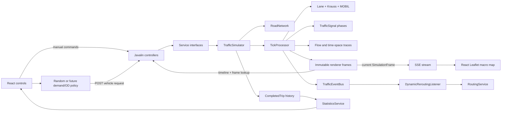

# Architecture

The Traffic Event System is a layered Java and React application. The backend
owns the road graph, routing, simulation clock, events, and statistics. The
frontend consumes REST endpoints and a Server-Sent Events stream to render the
current state on an OpenStreetMap basemap.

## Runtime layers

| Layer | Responsibility |
|---|---|
| Domain | Roads/lane geometry, vehicles, signals, routes, positioned events, and statistics records |
| Routing | Interchangeable BFS, Dijkstra, and A* strategies |
| Simulation | Seconds-based clock, sub-step dynamics, event overlays, immutable renderer-frame replay, diagnostics, and completed-trip history |
| Services | Use-case boundaries for networks, routing, vehicles, events, simulation, and statistics |
| API | Javalin controllers, DTOs, static frontend hosting, and the live SSE stream |
| Persistence | JSON/CSV map loading, JSON export, validation, and synthetic grids |
| Integration | Optional OSRM road geometry with a straight-line fallback |
| Visualization | React/Leaflet macro map (roads, pressure, routes, incidents), controls, editor, statistics, and experiment comparison |

`RoadNetwork` is the graph aggregate. It owns intersections and directed roads,
including incoming and outgoing adjacency indexes. `TrafficSimulator` is the
simulation aggregate. It owns the active vehicles and events, advances the
clock through `TickProcessor`, and archives a `CompletedTrip` when an arrived
vehicle exits the simulation.

Each directed `Road` carries a stable physical-road id, lane count, lane width,
class, and optional polyline. `RoadLayout` is the narrow read boundary used by
dynamics. `Junction` is derived from the network; degree-two shape points are
not treated as controlled intersections.

`VehicleDynamicsEngine` splits each logical tick into sub-steps of at most one
simulated second. Each sub-step captures immutable `TrafficState`, arbitrates
stop-line approaches (including `TrafficSignal` phases), plans all car-following
and MOBIL lane changes, then commits them. `Motorcycle` selects a dedicated
low-incentive MOBIL strategy; its compact physical and driver profiles let it
use safe openings that reject a car without weakening target-follower braking
safety. That order preserves the existing vehicle-list order-independence
invariant.

After each post-movement sub-step, `SimulationFrameHistory` captures an
immutable renderer frame. `TickProcessor` also reports exact event boundaries,
so the frame at that timestamp contains the final activated/resolved overlay.
The bounded history is indexed by simulated milliseconds and exposed by one
`timelineId`; network edits reset that id because map geometry is not copied
into every frame.

Traffic changes are published through `TrafficEventBus`. `TrafficEventCoordinator`
rebuilds road effects from a baseline plus all still-active overlays, so events
that overlap or resolve out of order do not corrupt road state.
`DynamicReroutingListener` recalculates only routes whose remaining steps use
the affected road. `MapImportService` validates a complete replacement graph
before changing live state. `ExperimentService` works on isolated networks and
does not mutate the live simulation.

## Current project structure

```text
Traffic-Event-System/
|-- data/
|   |-- maps/                     the District 1 road network (input)
|   |-- scenarios/                run scripts (input) -- being redesigned
|   `-- results/                  generated output; traces land here
|-- docs/                         architecture, class diagram, algorithms, API, demo, results
|-- frontend/
|   |-- public/assets/            artwork slots: vehicles, surfaces, buildings (see ASSETS.md)
|   `-- src/
|       |-- api/trafficAPI.js     REST/SSE client
|       |-- components/
|       |   |-- TrafficMap.jsx
|       |   |-- NetworkEditor.jsx
|       |   |-- TimelineScrubber.jsx
|       |   `-- ExperimentPanel.jsx
|       |-- physical/                 PixiJS lane-level renderer
|       |   |-- PhysicalScene.jsx      owns the app, polls, follows the camera
|       |   |-- sceneTransform.js      metres <-> world units
|       |   |-- interpolate.js         smoothing between two live frames
|       |   |-- vehicleSprites.js      textures, baked or loaded
|       |   |-- assetManifest.js       every artwork slot
|       |   `-- layers/drawScene.js    ground, blocks, road, markings, signals
|       |-- hooks/useTrafficDashboard.js
|       |-- demoTraffic.js
|       |-- spawnPolicies.js             pluggable vehicle-request planning
|       |-- App.jsx
|       `-- styles.css
|-- src/main/java/team/traffic/
|   |-- api/                      server, routes, controllers, DTOs
|   |-- domain/
|   |   |-- network/              roads, intersections, buildings, geo points
|   |   |-- vehicle/              hierarchy, dynamics, pose
|   |   |-- scene/                lane geometry derived for the physical view
|   |   |-- signal/ event/ routing/ statistics/
|   |-- experiment/               deterministic comparison runner
|   |-- observer/                 traffic event bus and listener
|   |-- persistence/              JSON/CSV loaders, saver, synthetic maps
|   |-- routing/                  BFS, Dijkstra, A*, registry, dynamic rerouting
|   |-- service/                  interfaces and implementations
|   `-- simulation/               simulator, clock, configs, frame history, flow/trajectory traces
|-- src/test/java/team/traffic/   domain, service, API, persistence, routing, simulation tests
|-- tools/generate_osm_map.py     District 1 OpenStreetMap dataset generator
|-- pom.xml
|-- run-demo.sh
`-- run-demo.ps1
```

`randomBoundarySpawnPolicy` is a frontend request-planning seam, not a second
simulation authority. It selects a reachable boundary trip and a CAR/MOTORCYCLE
type, then `useTrafficDashboard` sends the normal `POST /api/vehicles` command.
The backend still validates the endpoints, computes the route, owns every tick,
and publishes the pose rendered by both map modes. A future commuter policy can
implement the same `plan(...)` result shape while using OSM land-use/POI groups
such as home → work; the button and vehicle API do not need to change.
When React reconnects to an already `RUNNING` server, the dashboard restores its
local boundary-fleet coordinator flag so arrived demo vehicles continue to be
replaced; playback itself remains server-owned.

## Live data flow



## OOP and design patterns

| Requirement | Implementation |
|---|---|
| Encapsulation | Domain objects validate and manage their own mutable state |
| Inheritance | `Vehicle` and `TrafficEvent` define shared abstract behavior |
| Polymorphism | Routing strategies and event/vehicle subclasses are used through abstractions |
| Abstraction | Controllers depend on service interfaces; routing uses `PathFindingStrategy` |
| Strategy | BFS/Dijkstra/A*, car-following, lane-changing, and right-of-way policies |
| Observer | `TrafficEventBus`, `TrafficEventListener`, and dynamic rerouting |
| Factory | `VehicleFactory` creates car, motorcycle, bus, and emergency variants |
| MVC-like separation | React view, API/controllers, services, and domain model |

## Member contributions

| Member | Primary area |
|---|---|
| Binh | Road network and persistence |
| Nguyie | Routing algorithms |
| Hyo | Vehicles and traffic events |
| An | Simulation, API, services, and frontend |

See [CLASS_DIAGRAM.md](CLASS_DIAGRAM.md) for the implemented class
relationships and [API_CONTRACT.md](API_CONTRACT.md) for the external HTTP
boundary. See [PHYSICAL_VIEW_PLAN.md](PHYSICAL_VIEW_PLAN.md) for the proposed
local-PBF ingestion pipeline and the separate microscopic renderer boundary.
