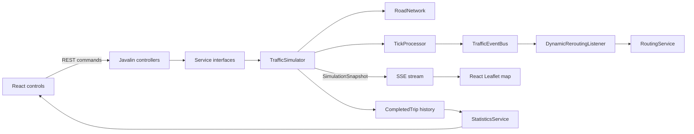

# Architecture

The Traffic Event System is a layered Java and React application. The backend
owns the road graph, routing, simulation clock, events, and statistics. The
frontend consumes REST endpoints and a Server-Sent Events stream to render the
current state on an OpenStreetMap basemap.

## Runtime layers

| Layer | Responsibility |
|---|---|
| Domain | Encapsulated roads, intersections, vehicles, routes, events, and statistics records |
| Routing | Interchangeable BFS, Dijkstra, and A* strategies |
| Simulation | Ticks, vehicle progress, traffic-light waits, event activation, and completed-trip history |
| Services | Use-case boundaries for networks, routing, vehicles, events, simulation, and statistics |
| API | Javalin controllers, DTOs, static frontend hosting, and the live SSE stream |
| Persistence | JSON/CSV map loading, JSON export, validation, and synthetic grids |
| Integration | Optional OSRM road geometry with a straight-line fallback |
| Visualization | React/Leaflet map, controls, editor, statistics, and experiment comparison |

`RoadNetwork` is the graph aggregate. It owns intersections and directed roads,
including incoming and outgoing adjacency indexes. `TrafficSimulator` is the
simulation aggregate. It owns the active vehicles and events, advances the
clock through `TickProcessor`, and archives a `CompletedTrip` when an arrived
vehicle exits the simulation.

Traffic changes are published through `TrafficEventBus`.
`DynamicReroutingListener` recalculates only routes whose remaining steps use
the affected road. `MapImportService` validates a complete replacement graph
before changing live state. `ExperimentService` works on isolated networks and
does not mutate the live simulation.

## Current project structure

```text
Traffic-Event-System/
|-- data/                         JSON/CSV maps, simulation config, experiment baseline
|-- docs/                         architecture, class diagram, algorithms, API, demo, results
|-- frontend/
|   |-- public/vehicles/          top-view SVG vehicle markers
|   `-- src/
|       |-- api/trafficAPI.js     REST/SSE client
|       |-- components/
|       |   |-- TrafficMap.jsx
|       |   |-- NetworkEditor.jsx
|       |   `-- ExperimentPanel.jsx
|       |-- hooks/useTrafficDashboard.js
|       |-- demoTraffic.js
|       |-- App.jsx
|       `-- styles.css
|-- src/main/java/team/traffic/
|   |-- api/                      server, routes, controllers, DTOs
|   |-- domain/                   network, vehicle, route, event, statistics objects
|   |-- experiment/               deterministic comparison runner
|   |-- observer/                 traffic event bus and listener
|   |-- persistence/              JSON/CSV loaders, saver, synthetic maps
|   |-- routing/                  BFS, Dijkstra, A*, registry, dynamic rerouting
|   |-- service/                  interfaces and implementations
|   `-- simulation/               simulator, clock, ticks, configs, snapshots
|-- src/test/java/team/traffic/   domain, service, API, persistence, routing, simulation tests
|-- tools/generate_osm_map.py     District 1 OpenStreetMap dataset generator
|-- pom.xml
|-- run-demo.sh
`-- run-demo.ps1
```

## Live data flow



## OOP and design patterns

| Requirement | Implementation |
|---|---|
| Encapsulation | Domain objects validate and manage their own mutable state |
| Inheritance | `Vehicle` and `TrafficEvent` define shared abstract behavior |
| Polymorphism | Routing strategies and event/vehicle subclasses are used through abstractions |
| Abstraction | Controllers depend on service interfaces; routing uses `PathFindingStrategy` |
| Strategy | BFS, Dijkstra, and A* implementations |
| Observer | `TrafficEventBus`, `TrafficEventListener`, and dynamic rerouting |
| Factory | `VehicleFactory` creates car, bus, and emergency variants |
| MVC-like separation | React view, API/controllers, services, and domain model |

## Member contributions

| Member | Primary area |
|---|---|
| Binh | Road network and persistence |
| Nguyie | Routing algorithms |
| Hyo | Vehicles and traffic events |
| An | Simulation, API, services, and frontend |

See [CLASS_DIAGRAM.md](CLASS_DIAGRAM.md) for the implemented class
relationships and [API_CONTRACT.md](API_CONTRACT.md) for the external HTTP
boundary.
