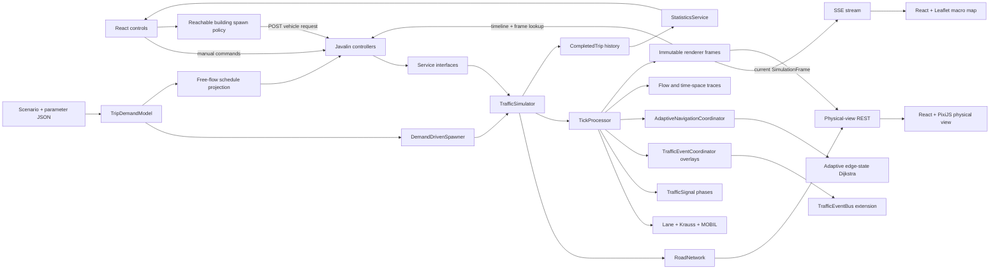

# Architecture

The Traffic Event System is a layered Java and React application. The backend
owns the road graph, routing, simulation clock, physical state, events, and
statistics. The frontend consumes REST endpoints and a Server-Sent Events
stream. React-Leaflet renders the geographic macro view; React and PixiJS render
the lane-level physical view. Neither renderer advances the simulation.

## Runtime layers

| Layer | Responsibility |
|---|---|
| Domain | Roads/lane geometry, vehicles, resolved demand plans, signals, routes, positioned events, and statistics records |
| Routing | Interchangeable BFS, Dijkstra, and A* strategies |
| Simulation | Seconds-based clock, demand spawning, authoritative building access links, multi-leg/dwell lifecycle, sub-step dynamics, event overlays, immutable renderer-frame replay, diagnostics, and completed-trip history |
| Services | Use-case boundaries for networks, routing, vehicles, events, simulation, and statistics |
| API | Javalin controllers, DTOs, static frontend hosting, and the live SSE stream |
| Persistence | JSON/CSV map loading, complete scenario/demand loading, JSON export, validation, and synthetic grids |
| Integration | Optional OSRM road geometry with a straight-line fallback |
| Visualization | React-Leaflet macro map, React/PixiJS physical view, controls, editor, statistics, and experiment comparison |

`RoadNetwork` is the graph aggregate. It owns intersections and directed roads,
including incoming and outgoing adjacency indexes. `TrafficSimulator` is the
simulation aggregate. It owns the active vehicles and events, advances the
clock through `TickProcessor`, and archives a `CompletedTrip` when an arrived
vehicle exits the simulation.

Each directed `Road` carries a stable physical-road id, lane count, lane width,
class, and optional polyline. `RoadLayout` is the narrow read boundary used by
dynamics. `Junction` is derived from the network; degree-two shape points are
not treated as controlled intersections.

`VehicleDynamicsEngine` splits each logical tick into sub-steps of at most one
simulated second. Each sub-step captures immutable `TrafficState`, arbitrates
stop-line approaches (including `TrafficSignal` phases), plans all car-following
and MOBIL lane changes, then commits them. `Motorcycle` selects a dedicated
low-incentive MOBIL strategy; its compact physical and driver profiles let it
use safe openings that reject a car without weakening target-follower braking
safety. Once a lane change is accepted, `LateralMotionModel` advances a signed
offset continuously towards the target lane centre instead of teleporting
sideways. That order preserves the existing vehicle-list order-independence
invariant.

At detail cadence `SimulationFrameHistory` captures each post-movement
sub-step. For large overview ticks the simulator retains at most three
intermediate physics frames plus the final frame, while `TickProcessor` always
reports exact state/event boundaries. This avoids copying the complete
730-road frame dozens of times per scheduler callback without losing a
transition. The bounded history is indexed by simulated milliseconds and
exposed by one `timelineId`; network edits reset that id because map geometry
is not copied into every frame.

`TrafficEventCoordinator` rebuilds road effects from a baseline plus all
still-active overlays, so events that overlap or resolve out of order do not
corrupt road state. `TickProcessor` also publishes event transitions through
`TrafficEventBus`, which remains an Observer extension boundary. The production
application does not subscribe `DynamicReroutingListener`; current adaptive
rerouting is instead coordinated by `AdaptiveNavigationCoordinator`, using
driver information access and latency, observed congestion, route savings,
cooldowns, and cause-specific stall state. This distinction matters: event
publication and route choice are related inputs, not the same mechanism.

`MapImportService` validates a complete replacement graph before changing live
state. `ExperimentService` works on isolated networks and does not mutate the
live simulation.

## State ownership, snapshots, and failure boundaries

`TrafficSimulator` synchronizes aggregate reads and mutations. Continuous
playback runs on one scheduled executor thread, while API commands enter through
the same synchronized simulator boundary. Collection getters and
`SimulationSnapshot` copy their list containers, so callers cannot add or remove
entries from the simulator's lists.

That protection is intentionally not described as deep immutability:
`SimulationSnapshot` still refers to mutable `Vehicle`, `TrafficEvent`, and
`TrafficSignal` domain objects. It is suitable for immediately materializing a
REST DTO, but it is not the renderer/replay consistency contract.
`SimulationFrame` is that contract: it captures value records and copied
collections under the simulator boundary, and the SSE, frame-history, macro-map,
and physical-view paths read those immutable values.

If a scheduled tick throws a runtime failure, `SimulationServiceImpl` logs it at
`SEVERE`, attempts to move the simulator to `PAUSED`, cancels future scheduled
ticks, and publishes the resulting snapshot. If pausing itself fails, both
failures are logged and the runner remains cancelled. Fatal JVM `Error`s receive
the same cleanup before being rethrown. A failed scheduled tick therefore cannot
silently leave a nominal playback loop advancing.

## Current project structure

```text
Traffic-Event-System/
|-- data/
|   |-- maps/                     the District 1 road network (input)
|   |-- demand/                   replaceable parameter and curve tables
|   |-- scenarios/                complete seeded runs (input)
|   `-- results/                  generated output; traces land here
|-- docs/                         architecture, class diagram, algorithms, API, demo, results
|-- frontend/
|   |-- public/assets/            artwork slots: vehicles, surfaces, land, buildings (see ASSETS.md)
|   `-- src/
|       |-- api/trafficAPI.js     REST/SSE client
|       |-- components/
|       |   |-- TrafficMap.jsx
|       |   |-- DemandSchedulePanel.jsx
|       |   |-- NetworkEditor.jsx
|       |   |-- TimelineScrubber.jsx
|       |   `-- ExperimentPanel.jsx
|       |-- physical/                 PixiJS lane-level renderer
|       |   |-- PhysicalScene.jsx      owns the app, polls, follows the camera
|       |   |-- sceneTransform.js      metres <-> world units
|       |   |-- interpolate.js         smoothing between two live frames
|       |   |-- vehicleSprites.js      textures, baked or loaded
|       |   |-- assetManifest.js       every artwork slot
|       |   `-- layers/drawScene.js    ground, blocks, road, markings, signals
|       |-- hooks/useTrafficDashboard.js
|       |-- displayLabels.js             human-readable road/building labels
|       |-- simulationTime.js            24-hour clock/day-offset projection
|       |-- spawnPolicies.js             pluggable vehicle-request planning
|       |-- App.jsx
|       `-- styles.css
|-- src/main/java/team/traffic/
|   |-- api/                      server, routes, controllers, DTOs
|   |-- domain/
|   |   |-- demand/               sources, place resolution, plans, model strategies
|   |   |-- network/              roads, intersections, buildings, geo points
|   |   |-- vehicle/              hierarchy, dynamics, pose
|   |   |-- scene/                lane geometry derived for the physical view
|   |   |-- signal/ event/ routing/ statistics/
|   |-- experiment/               deterministic comparison runner
|   |-- observer/                 traffic-event Observer extension boundary
|   |-- persistence/              JSON/CSV loaders, saver, synthetic maps
|   |-- routing/                  BFS, Dijkstra, A*, registry, route snapshots
|   |-- service/                  interfaces and implementations
|   `-- simulation/               simulator, clock, adaptive navigation, frame history, traces
|-- src/test/java/team/traffic/   domain, service, API, persistence, routing, simulation tests
|-- tools/generate_osm_map.py     District 1 OpenStreetMap dataset generator
|-- pom.xml
|-- run-demo.sh
`-- run-demo.ps1
```

`randomBuildingSpawnPolicy` is a frontend request-planning seam, not a second
simulation authority. It prefers a residential source, excludes a destination
on the same access node, checks directed reachability, and selects a
CAR/MOTORCYCLE type using the documented citywide registered-stock ratio as a
test proxy. `useTrafficDashboard` sends the normal building-form
`POST /api/vehicles` command. The backend still resolves the access pair,
computes the route, advances both driveway links and every road tick, and
publishes the pose rendered by both map modes.

Generated scenario traffic follows a separate backend-owned path:
`JsonScenarioLoader` resolves a map and parameter catalog,
`GravityDemandModel` deterministically expands source/flow data into exact
`TripPlan`s, and `DemandDrivenSpawner` creates due vehicles. `Vehicle` advances
the same identity through every resolved leg and dwell, while
`RETURN_TO_ORIGIN` plans end at the exact concrete origin.
`TripScheduleEstimator` projects those already-resolved plans onto a directed
free-flow timetable for a requested page of
`GET /api/simulation/demand/schedule`; it is a reader-facing estimate, never a
second runtime model. Full-day hourly/purpose/vehicle aggregates are computed
without routing every plan for each request.

The shipped scenario performs a five-minute initialization pre-roll through
the same demand spawner, signals, arbitration and microscopic dynamics as live
playback. Its intermediate frames and traces are intentionally discarded; the
resulting populated 06:05 state becomes the first frame of the interactive
session. This is scenario initialization, not frontend fast-forward.

On a normal launch, `App` loads and initializes the complete file selected by
`SCENARIO_FILE`, defaulting to `data/scenarios/district1_typical_day.json`,
before the HTTP server starts. If `SCENARIO_FILE` is unset and `MAP_FILE` is
explicitly set, startup is topology-only instead. Scenario activation through
the API repeats the complete map/configuration/demand initialization boundary.

## Live data flow



The macro map consumes current or retained `SimulationFrame` data. The physical
view loads network-derived static geometry once per timeline, then polls a
lighter state response whose vehicles and signals come from the current frame
within the camera radius plus overscan. State coordinates are rebased onto the
retained static origin, and off-viewport vehicle sprites/trails are culled
before Pixi submission.
The Physical View is lazy-loaded, keeping PixiJS out of the initial Leaflet
dashboard bundle. PixiJS interpolates only between received poses for display
smoothness: it samples backend-provided lane/connector topology and blends
authoritative headings, but it does not run lane changes, collision handling,
junction arbitration, or a second physics simulation.

Building access is not frontend interpolation. `Vehicle` advances
`DEPARTING_ORIGIN` and `ARRIVING_DESTINATION` at 15 km/h without road
occupancy; `VehiclePoseResolver` publishes each authoritative body-centre pose.
The frontend may smooth only between those successive poses.

## Performance and GPU boundary

PixiJS 8 normally uses WebGL, so rasterization, transforms, and sprite
composition in the Physical View use the GPU when browser hardware
acceleration is available. The Java simulator remains deliberately CPU-owned:
routing, graph mutations, signal/right-of-way arbitration, stateful
car-following, events, and deterministic ordering do not map cleanly to a GPU
kernel at this scale. A GPU-compute rewrite would add transfer/synchronization
cost and a second implementation surface without fixing an interpolation or
data-contract bug.

The implemented controls target the actual bottlenecks:

- static Pixi geometry is retained once per timeline; the view is lazy-loaded
  and capped at 60 FPS;
- physical state is lightweight and polled at 250 ms while changing;
- physical state requests follow the camera viewport instead of serializing the
  district-wide fleet;
- while Physical View is mounted, the full `SimulationFrame` SSE and snapshot
  fallback are closed rather than parsed behind the overlay; a one-second
  lightweight status poll keeps backend RUNNING/PAUSED/READY, clock and pace
  truthful without carrying fleet/road arrays;
- SSE supplies the live head directly; the timeline index is refreshed at most
  once per wall second and statistics at most once every two seconds;
- renderer history retains 900 timestamps, vehicle traces 5,000 ticks, and
  flow history 100,000 samples;
- long-dwell agents remain in the simulator/statistics for their return leg but
  are omitted from renderer frames and traces until they re-depart;
- expired vehicles are removed as a batch before one final frame rather than
  copying one full scene per removal;
- generated plans are ordered once, due-plan intervals use binary bounds, and
  reusable origin/leg destination candidates and gravity weights are cached;
- the demand schedule endpoint routes only a bounded page (default 250, maximum
  1,000) instead of all 38,518 plans;
- **Real time**, **Balanced**, and **24 h overview** run at approximately 1×,
  10×, and 120× simulated time. A 24-hour demand scenario may use overview
  pace on the macro map; opening Physical View forces 0.25 s / 250 ms live
  cadence, so a 30-second overview tick is never used for turn inspection.

## OOP and design patterns

| Requirement | Implementation |
|---|---|
| Encapsulation | Domain objects validate and manage their own mutable state |
| Inheritance | `Vehicle` and `TrafficEvent` define shared abstract behavior |
| Polymorphism | Routing strategies and event/vehicle subclasses are used through abstractions |
| Abstraction | Controllers depend on service interfaces; routing uses `PathFindingStrategy` |
| Strategy | BFS/Dijkstra/A*, trip-demand models, car-following, lane-changing, and right-of-way policies |
| Observer | `TrafficEventBus`/`TrafficEventListener` as an event extension point; snapshot listeners feeding SSE |
| Factory | `VehicleFactory` creates car, motorcycle, bus, and emergency variants |
| MVC-like separation | React view, API/controllers, services, and domain model |

## Member contributions

| Member | Primary area |
|---|---|
| Binh | Road network and persistence |
| Nguyie | Routing algorithms |
| Hyo | Vehicles and traffic events |
| An | Simulation, API, services, and frontend |

See [CLASS_DIAGRAM.md](CLASS_DIAGRAM.md) for the implemented class
relationships and [API_CONTRACT.md](API_CONTRACT.md) for the external HTTP
boundary. See [PHYSICAL_VIEW_PLAN.md](PHYSICAL_VIEW_PLAN.md) for local-PBF
ingestion roadmap notes and the background behind the microscopic renderer
boundary.
