# Final Folder Structure and Class Diagram

This document combines the planning work from all four members into one final reference for the Traffic Event System project.

## Member Contributions

| Member | Area |
|---|---|
| Binh | Road network and persistence |
| Nguyie | Routing algorithms |
| Hyo | Vehicle and traffic events |
| An | Simulation, API, services, and frontend |

## Complete Folder Structure

```text
Traffic-Event-System/
|-- pom.xml
|-- README.md
|-- .gitignore
|-- .editorconfig
|
|-- data/
|   |-- sample_map.csv
|   |-- sample_map.json
|   |-- small_city.json
|   |-- congestion_demo.json
|   `-- accident_demo.json
|
|-- docs/
|   |-- ARCHITECTURE.md
|   |-- CLASS_DIAGRAM.md
|   |-- PLANNING_OVERVIEW.md
|   |-- API_CONTRACT.md
|   |-- ALGORITHM_EXPLANATION.md
|   |-- EXPERIMENT_RESULTS.md
|   |-- PRESENTATION_SCRIPT.md
|   `-- planning/
|       |-- Binh-network-persistence.md
|       |-- nguynie-routing-algorithms.md
|       |-- Hyo-vehicle-traffic_event.md
|       `-- An-simulation-API-services-frontend.md
|
|-- frontend/
|   |-- package.json
|   |-- vite.config.js
|   |-- index.html
|   `-- src/
|       |-- main.jsx
|       |-- App.jsx
|       |-- styles.css
|       |
|       |-- api/
|       |   `-- trafficApi.js
|       |
|       |-- hooks/
|       |   |-- useRoadNetwork.js
|       |   |-- useSimulation.js
|       |   `-- useAlgorithms.js
|       |
|       `-- components/
|           |-- MapViewport.jsx
|           |-- ControlPanel.jsx
|           |-- AlgorithmPanel.jsx
|           |-- EventPanel.jsx
|           |-- VehiclePanel.jsx
|           `-- StatisticsPanel.jsx
|
`-- src/
    |-- main/
    |   `-- java/
    |       `-- team/
    |           `-- traffic/
    |               |-- App.java
    |               |
    |               |-- config/
    |               |   `-- ApplicationConfig.java
    |               |
    |               |-- api/
    |               |   |-- TrafficApiServer.java
    |               |   |-- ApiRouteRegistry.java
    |               |   |
    |               |   |-- controller/
    |               |   |   |-- HealthController.java
    |               |   |   |-- NetworkController.java
    |               |   |   |-- RoutingController.java
    |               |   |   |-- VehicleController.java
    |               |   |   |-- TrafficEventController.java
    |               |   |   |-- SimulationController.java
    |               |   |   `-- StatisticsController.java
    |               |   |
    |               |   `-- dto/
    |               |       |-- ApiResponse.java
    |               |       |-- RouteRequestDto.java
    |               |       |-- RouteResultDto.java
    |               |       |-- VehicleDto.java
    |               |       |-- TrafficEventDto.java
    |               |       `-- SimulationSnapshotDto.java
    |               |
    |               |-- domain/
    |               |   |-- network/
    |               |   |   |-- RoadNetwork.java
    |               |   |   |-- Intersection.java
    |               |   |   |-- Road.java
    |               |   |   |-- RoadCondition.java
    |               |   |   |-- RoadStatus.java
    |               |   |   `-- LocationType.java
    |               |   |
    |               |   |-- vehicle/
    |               |   |   |-- Vehicle.java
    |               |   |   |-- Car.java
    |               |   |   |-- Bus.java
    |               |   |   |-- EmergencyVehicle.java
    |               |   |   |-- VehicleFactory.java
    |               |   |   |-- VehicleType.java
    |               |   |   `-- VehicleStatus.java
    |               |   |
    |               |   |-- routing/
    |               |   |   |-- Route.java
    |               |   |   |-- RouteStep.java
    |               |   |   |-- RouteRequest.java
    |               |   |   |-- RouteResult.java
    |               |   |   `-- RoutePreference.java
    |               |   |
    |               |   |-- event/
    |               |   |   |-- TrafficEvent.java
    |               |   |   |-- CongestionEvent.java
    |               |   |   |-- AccidentEvent.java
    |               |   |   |-- RoadClosureEvent.java
    |               |   |   |-- TrafficLightDelayEvent.java
    |               |   |   |-- TrafficEventType.java
    |               |   |   `-- TrafficEventStatus.java
    |               |   |
    |               |   `-- statistics/
    |               |       |-- TrafficStatistics.java
    |               |       `-- AlgorithmStatistics.java
    |               |
    |               |-- routing/
    |               |   |-- PathFindingStrategy.java
    |               |   |-- BfsPathFindingStrategy.java
    |               |   |-- DijkstraPathFindingStrategy.java
    |               |   |-- AStarPathFindingStrategy.java
    |               |   |-- RoutingStrategyRegistry.java
    |               |   `-- Heuristic.java
    |               |
    |               |-- simulation/
    |               |   |-- TrafficSimulator.java
    |               |   |-- TickProcessor.java
    |               |   |-- SimulationClock.java
    |               |   |-- SimulationSnapshot.java
    |               |   |-- SimulationCommand.java
    |               |   `-- SimulationStatus.java
    |               |
    |               |-- service/
    |               |   |-- RoadNetworkService.java
    |               |   |-- RoutingService.java
    |               |   |-- VehicleService.java
    |               |   |-- TrafficEventService.java
    |               |   |-- SimulationService.java
    |               |   |-- StatisticsService.java
    |               |   |
    |               |   `-- impl/
    |               |       |-- RoadNetworkServiceImpl.java
    |               |       |-- RoutingServiceImpl.java
    |               |       |-- VehicleServiceImpl.java
    |               |       |-- TrafficEventServiceImpl.java
    |               |       |-- SimulationServiceImpl.java
    |               |       `-- StatisticsServiceImpl.java
    |               |
    |               |-- observer/
    |               |   |-- TrafficEventBus.java
    |               |   `-- TrafficEventListener.java
    |               |
    |               |-- persistence/
    |               |   |-- MapLoader.java
    |               |   |-- CsvMapLoader.java
    |               |   |-- JsonMapLoader.java
    |               |   |-- MapSaver.java
    |               |   `-- SyntheticMapGenerator.java
    |               |
    |               `-- exception/
    |                   |-- InvalidMapException.java
    |                   |-- RouteNotFoundException.java
    |                   `-- SimulationException.java
    |
    `-- test/
        `-- java/
            `-- team/
                `-- traffic/
                    |-- RoadNetworkTest.java
                    |-- MapLoaderTest.java
                    |-- RoutingStrategyTest.java
                    |-- VehicleTest.java
                    |-- TrafficEventTest.java
                    `-- SimulationTest.java
```

## Class Diagram

```mermaid
classDiagram
    direction LR

    class RoadNetwork {
        -Map~String, Intersection~ intersections
        -Map~String, Road~ roads
        +addIntersection(Intersection)
        +removeIntersection(String)
        +addRoad(Road)
        +removeRoad(String)
        +findOutgoingRoads(String) List~Road~
        +findIncomingRoads(String) List~Road~
        +updateRoadCondition(String, RoadCondition)
    }

    class Intersection {
        -String id
        -String name
        -double x
        -double y
        -LocationType locationType
    }

    class Road {
        -String id
        -String startIntersectionId
        -String endIntersectionId
        -double distance
        -double speedLimit
        -int capacity
        -int currentVehicleCount
        -RoadCondition condition
        +calculateTravelCost() double
        +isAvailable() boolean
    }

    class RoadCondition {
        -double congestionLevel
        -double vehicleDensity
        -RoadStatus status
        +increaseCongestion(double)
        +markBlocked()
        +markOpen()
    }

    class RoadStatus {
        <<enumeration>>
        OPEN
        CONGESTED
        BLOCKED
        CLOSED
    }

    class LocationType {
        <<enumeration>>
        SCHOOL
        HOSPITAL
        BAR
        RESIDENTIAL
        COMMERCIAL
        NORMAL
    }

    RoadNetwork "1" *-- "*" Intersection
    RoadNetwork "1" *-- "*" Road
    Road --> RoadCondition
    RoadCondition --> RoadStatus
    Intersection --> LocationType

    class Vehicle {
        <<abstract>>
        -String id
        -String currentIntersectionId
        -String destinationIntersectionId
        -Route currentRoute
        -double movementSpeed
        -double length
        -double width
        -double maxSpeed
        -double currentSpeed
        -double acceleration
        -double deceleration
        -double vehicleWeight
        -int priorityLevel
        -String currentRoadId
        -String segmentStartIntersectionId
        -String segmentEndIntersectionId
        -double roadProgress
        -int nextRouteStepIndex
        -VehicleStatus status
        -List~String~ travelHistory
        +getType()* VehicleType
        +requestRoute(RoutingService)
        +moveOneStep()
        +recomputeRoute(RoutingService)
        +hasReachedDestination() boolean
        +advance(double, RoadNetwork)
        +accelerate(double)
        +decelerate(double)
    }

    class Car {
        +getType() VehicleType
    }

    class Bus {
        -int passengerCapacity
        +getType() VehicleType
    }

    class EmergencyVehicle {
        -int priorityLevel
        +getType() VehicleType
    }

    class VehicleFactory {
        +createVehicle(VehicleType, String, String) Vehicle
        +createCar(String, String) Car
        +createBus(String, String) Bus
        +createEmergencyVehicle(String, String) EmergencyVehicle
    }

    class VehicleType {
        <<enumeration>>
        CAR
        BUS
        EMERGENCY
    }

    class VehicleStatus {
        <<enumeration>>
        WAITING
        MOVING
        ARRIVED
        BLOCKED
    }

    Vehicle <|-- Car
    Vehicle <|-- Bus
    Vehicle <|-- EmergencyVehicle
    Vehicle --> Route
    Vehicle --> VehicleStatus
    Vehicle --> VehicleType
    VehicleFactory --> Vehicle

    class Route {
        -List~RouteStep~ steps
        -double totalDistance
        -double estimatedTravelTime
        -double totalCost
    }

    class RouteStep {
        -String fromIntersectionId
        -String toIntersectionId
        -String roadId
        -double cost
    }

    class RouteRequest {
        -String startIntersectionId
        -String destinationIntersectionId
        -RoutePreference preference
    }

    class RouteResult {
        -Route route
        -String algorithmName
        -long computationTimeMillis
        -int visitedNodes
    }

    class RoutePreference {
        <<enumeration>>
        SHORTEST_DISTANCE
        SHORTEST_TIME
        CONGESTION_AWARE
    }

    Route "1" *-- "*" RouteStep
    RouteRequest --> RoutePreference
    RouteResult --> Route

    class PathFindingStrategy {
        <<interface>>
        +getName() String
        +supports(RoutePreference) boolean
        +findRoute(RoadNetwork, RouteRequest) RouteResult
    }

    class BfsPathFindingStrategy
    class DijkstraPathFindingStrategy
    class AStarPathFindingStrategy

    class Heuristic {
        <<interface>>
        +estimate(Intersection, Intersection) double
    }

    class RoutingStrategyRegistry {
        -List~PathFindingStrategy~ strategies
        +register(PathFindingStrategy)
        +findByName(String) PathFindingStrategy
        +findForPreference(RoutePreference) PathFindingStrategy
    }

    PathFindingStrategy <|.. BfsPathFindingStrategy
    PathFindingStrategy <|.. DijkstraPathFindingStrategy
    PathFindingStrategy <|.. AStarPathFindingStrategy
    AStarPathFindingStrategy --> Heuristic
    RoutingStrategyRegistry "1" *-- "*" PathFindingStrategy

    class TrafficEvent {
        <<abstract>>
        -String id
        -String affectedRoadId
        -long startTick
        -long durationTicks
        -TrafficEventStatus status
        +getType()* TrafficEventType
        +apply(RoadNetwork)
        +resolve(RoadNetwork)
        +isActive(long) boolean
    }

    class CongestionEvent {
        -double congestionIncrease
    }

    class AccidentEvent {
        -double capacityReduction
        -String causingVehicleId
    }

    class RoadClosureEvent

    class TrafficLightDelayEvent {
        -long delayTicks
    }

    class TrafficEventType {
        <<enumeration>>
        CONGESTION
        ACCIDENT
        ROAD_CLOSURE
        TRAFFIC_LIGHT_DELAY
    }

    class TrafficEventStatus {
        <<enumeration>>
        SCHEDULED
        ACTIVE
        RESOLVED
    }

    TrafficEvent <|-- CongestionEvent
    TrafficEvent <|-- AccidentEvent
    TrafficEvent <|-- RoadClosureEvent
    TrafficEvent <|-- TrafficLightDelayEvent
    TrafficEvent --> TrafficEventType
    TrafficEvent --> TrafficEventStatus

    class TrafficEventListener {
        <<interface>>
        +onTrafficEvent(TrafficEvent)
    }

    class TrafficEventBus {
        -List~TrafficEventListener~ listeners
        +subscribe(TrafficEventListener)
        +unsubscribe(TrafficEventListener)
        +publish(TrafficEvent)
    }

    TrafficEventBus --> TrafficEventListener
    TrafficEventBus --> TrafficEvent

    class TrafficSimulator {
        -RoadNetwork roadNetwork
        -List~Vehicle~ vehicles
        -List~TrafficEvent~ events
        -SimulationClock clock
        -SimulationStatus status
        +start()
        +pause()
        +resume()
        +reset()
        +advanceOneTick()
        +createSnapshot() SimulationSnapshot
    }

    class TickProcessor {
        +processTick(TrafficSimulator)
        +moveVehicles()
        +processEvents()
        +updateCongestion()
    }

    class SimulationClock {
        -long currentTick
        +tick()
        +reset()
        +getCurrentTick() long
    }

    class SimulationSnapshot {
        -long tick
        -SimulationStatus status
        -List~Vehicle~ vehicles
        -RoadNetwork roadNetwork
        -TrafficStatistics statistics
    }

    class SimulationStatus {
        <<enumeration>>
        READY
        RUNNING
        PAUSED
        FINISHED
    }

    TrafficSimulator --> RoadNetwork
    TrafficSimulator --> Vehicle
    TrafficSimulator --> TrafficEvent
    TrafficSimulator --> SimulationClock
    TrafficSimulator --> SimulationSnapshot
    TrafficSimulator --> SimulationStatus
    TickProcessor --> TrafficSimulator

    class TrafficStatistics {
        -int totalVehicles
        -int arrivedVehicles
        -double averageTravelTime
        -double averageCongestionLevel
        -int blockedRoadCount
    }

    class AlgorithmStatistics {
        -String algorithmName
        -long averageComputationTime
        -int routeRecalculationCount
        -double averageRouteCost
        -int successfulRoutes
        -int failedRoutes
    }

    SimulationSnapshot --> TrafficStatistics

    class RoadNetworkService {
        <<interface>>
    }

    class RoutingService {
        <<interface>>
    }

    class VehicleService {
        <<interface>>
    }

    class TrafficEventService {
        <<interface>>
    }

    class SimulationService {
        <<interface>>
    }

    class StatisticsService {
        <<interface>>
    }

    class RoadNetworkServiceImpl
    class RoutingServiceImpl
    class VehicleServiceImpl
    class TrafficEventServiceImpl
    class SimulationServiceImpl
    class StatisticsServiceImpl

    RoadNetworkService <|.. RoadNetworkServiceImpl
    RoutingService <|.. RoutingServiceImpl
    VehicleService <|.. VehicleServiceImpl
    TrafficEventService <|.. TrafficEventServiceImpl
    SimulationService <|.. SimulationServiceImpl
    StatisticsService <|.. StatisticsServiceImpl

    RoutingServiceImpl --> RoutingStrategyRegistry
    VehicleServiceImpl --> VehicleFactory
    TrafficEventServiceImpl --> TrafficEventBus
    SimulationServiceImpl --> TrafficSimulator
    StatisticsServiceImpl --> TrafficStatistics
    StatisticsServiceImpl --> AlgorithmStatistics

    class MapLoader {
        <<interface>>
        +load(String) RoadNetwork
    }

    class CsvMapLoader
    class JsonMapLoader
    class MapSaver
    class SyntheticMapGenerator {
        +generateGridMap(int, int) RoadNetwork
    }

    MapLoader <|.. CsvMapLoader
    MapLoader <|.. JsonMapLoader
    CsvMapLoader --> RoadNetwork
    JsonMapLoader --> RoadNetwork
    SyntheticMapGenerator --> RoadNetwork
```



## Design Patterns

| Pattern | Classes |
|---|---|
| Strategy Pattern | `PathFindingStrategy`, `BfsPathFindingStrategy`, `DijkstraPathFindingStrategy`, `AStarPathFindingStrategy` |
| Factory Pattern | `VehicleFactory`, `Car`, `Bus`, `EmergencyVehicle` |
| Observer Pattern | `TrafficEventBus`, `TrafficEventListener`, `TrafficEvent` |
| MVC-like Separation | React components, API controllers, services, domain models |

## Layer Summary

| Layer | Purpose |
|---|---|
| Frontend | Shows the map, controls, vehicles, events, algorithms, and statistics. |
| API | Receives HTTP requests from the frontend and returns JSON responses. |
| Service | Coordinates each use case and connects API to domain logic. |
| Domain | Stores the main OOP models of the system. |
| Routing | Finds routes using BFS, Dijkstra, and AStar. |
| Simulation | Advances time, moves vehicles, processes events, and creates snapshots. |
| Persistence | Loads, saves, and generates road network maps. |
| Observer | Notifies the system when traffic events happen. |
