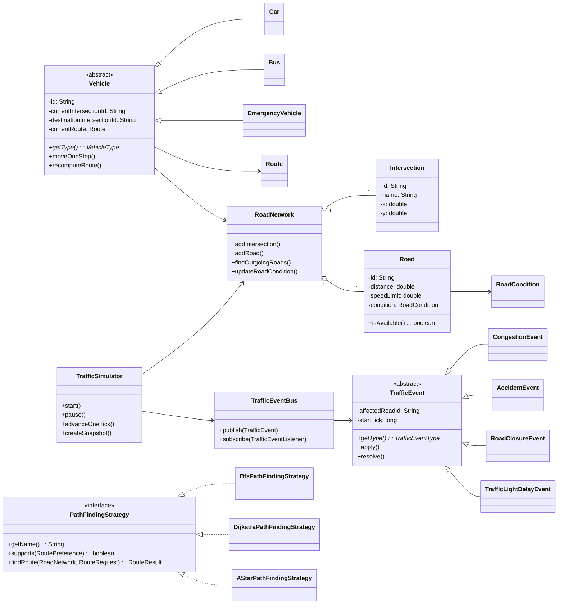
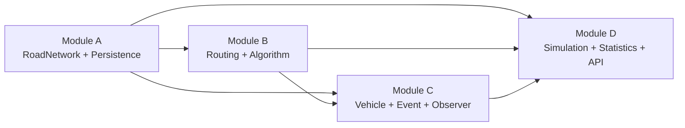

# Kiến trúc & Kế hoạch — Traffic Event System

> Tài liệu duy nhất mô tả kiến trúc hệ thống, design patterns, API contract, phân công và timeline.

## 1. Tổng quan

**Urban Traffic Simulator** — ứng dụng OOP mô phỏng giao thông đô thị.
Mô hình hóa roads, intersections, vehicles, traffic events, routing strategies
trên một graph. Hệ thống hoạt động theo tick-based simulation.

### Công nghệ

| Thành phần | Công nghệ |
|---|---|
| Backend | Java 17, Maven, JDK HttpServer |
| JSON | Jackson 2.17 |
| Test | JUnit 5 (Jupiter) |
| Frontend | React 19, Vite 7, CSS thuần |
| VCS | Git (feature branch workflow) |

---

## 2. Kiến trúc phân lớp

```text
Frontend (React) ──→ Backend API ──→ Service ──→ Domain / Routing / Simulation / Persistence
```

| Layer | Package / Thư mục | Vai trò |
|---|---|---|
| Frontend View | `frontend/src/components/` | Hiển thị map, vehicle, event, statistics |
| Frontend State | `frontend/src/hooks/` | State management & API call |
| Frontend API | `frontend/src/api/` | HTTP client contract |
| API | `hyo.traffic.api` | HttpServer, controllers, DTOs |
| Service | `hyo.traffic.service` | Use-case boundary (interface) |
| Service Impl | `hyo.traffic.service.impl` | Triển khai service |
| Domain | `hyo.traffic.domain.*` | Model nghiệp vụ cốt lõi |
| Routing | `hyo.traffic.routing` | Strategy tìm đường |
| Simulation | `hyo.traffic.simulation` | Tick engine, snapshot |
| Observer | `hyo.traffic.observer` | Event bus, listener |
| Persistence | `hyo.traffic.persistence` | Map loading/generation |
| Exception | `hyo.traffic.exception` | Lỗi nghiệp vụ |
| Config | `hyo.traffic.config` | Cấu hình runtime |

### Nguyên tắc

- Controller **không** implement logic — chỉ parse request, gọi service, trả response.
- Service **điều phối** use case, gọi domain/routing/persistence.
- Domain **giữ state** và hành vi nghiệp vụ.
- Algorithm **thay thế** qua interface (Strategy Pattern).
- Simulation **không** phụ thuộc UI.

---

## 3. Class Diagram (gọn)



---

## 4. Design Patterns

| Pattern | Áp dụng | Vị trí |
|---|---|---|
| **Strategy** | Routing algorithms có thể swap runtime | `PathFindingStrategy` → BFS, Dijkstra, A* |
| **Observer** | Thông báo khi road condition thay đổi | `TrafficEventBus` + `TrafficEventListener` |
| **Factory** | Tạo vehicle theo type mà không lộ constructor | `VehicleFactory` → Car, Bus, EmergencyVehicle |
| **MVC-like** | Tách view, controller, model | React components / Java controllers / Domain |

---

## 5. API Contract

| Method | Path | Mô tả |
|---|---|---|
| GET | `/api/health` | Health check |
| GET | `/api/network` | Lấy road network |
| POST | `/api/network/intersections` | Thêm intersection |
| DELETE | `/api/network/intersections/{id}` | Xóa intersection |
| POST | `/api/network/roads` | Thêm road |
| DELETE | `/api/network/roads/{id}` | Xóa road |
| PATCH | `/api/network/roads/{id}/condition` | Cập nhật điều kiện đường |
| POST | `/api/network/load` | Load map từ file |
| POST | `/api/network/generate` | Tạo map ngẫu nhiên |
| POST | `/api/routes` | Tìm route |
| POST | `/api/routes/recalculate/{vehicleId}` | Tính lại route |
| GET | `/api/routes/strategies` | Danh sách strategy |
| PUT | `/api/routes/strategy/{name}` | Chuyển strategy |
| POST | `/api/simulation/start` | Bắt đầu simulation |
| POST | `/api/simulation/pause` | Tạm dừng |
| POST | `/api/simulation/resume` | Tiếp tục |
| POST | `/api/simulation/reset` | Reset |
| POST | `/api/simulation/tick` | Advance 1 tick |
| GET | `/api/simulation/snapshot` | Lấy snapshot |
| POST | `/api/events` | Tạo event |
| POST | `/api/events/{id}/trigger` | Kích hoạt event |
| POST | `/api/events/{id}/resolve` | Giải quyết event |
| GET | `/api/events/active` | Danh sách event đang hoạt động |
| GET | `/api/statistics/traffic` | Traffic metrics |
| GET | `/api/statistics/algorithms/{name}` | Algorithm metrics |
| GET | `/api/statistics/algorithms` | So sánh algorithms |

---

## 6. Cấu trúc thư mục

```text
Traffic-Event-System/
├── pom.xml                          # Maven config (Java 17, JUnit 5, Jackson)
├── .editorconfig                    # Coding style
├── .gitignore
├── README.md
├── data/                            # Sample map files
│   ├── sample_map.csv
│   └── sample_map.json
├── docs/
│   └── ARCHITECTURE.md              # File này
├── frontend/
│   ├── package.json
│   ├── vite.config.js               # Proxy /api → localhost:8080
│   └── src/
│       ├── App.jsx
│       ├── main.jsx
│       ├── styles.css
│       ├── api/trafficApi.js
│       ├── hooks/
│       └── components/
└── src/
    ├── main/java/hyo/traffic/
    │   ├── App.java                 # Entry point
    │   ├── api/                     # Controllers, DTOs, HttpServer
    │   ├── config/                  # ApplicationConfig
    │   ├── domain/
    │   │   ├── event/               # TrafficEvent hierarchy
    │   │   ├── network/             # RoadNetwork, Road, Intersection
    │   │   ├── routing/             # Route, RouteRequest, RouteResult
    │   │   ├── statistics/          # Metrics classes
    │   │   └── vehicle/             # Vehicle hierarchy, Factory
    │   ├── exception/               # Domain exceptions
    │   ├── observer/                # EventBus, Listener
    │   ├── persistence/             # MapLoader, MapSaver, Generator
    │   ├── routing/                 # PathFindingStrategy implementations
    │   ├── service/                 # Service interfaces
    │   │   └── impl/                # Service implementations (skeleton)
    │   └── simulation/              # TrafficSimulator, Clock, Snapshot
    └── test/java/hyo/traffic/
        └── AppTest.java
```

---

## 7. Kế hoạch chia việc

> **Lưu ý**: Tên dưới đây là điển hình. Nhóm tự bàn bạc để phân công phù hợp năng lực từng người.

### Module & Phụ trách

| Module | Thành viên (điển hình) | Scope |
|---|---|---|
| **RoadNetwork + Persistence** | Thành viên A | `domain.network`, `persistence`, `service.impl.RoadNetworkServiceImpl` |
| **Routing + Algorithm** | Thành viên B | `routing`, `domain.routing`, `service.impl.RoutingServiceImpl` |
| **Vehicle + Event + Observer** | Thành viên C | `domain.vehicle`, `domain.event`, `observer`, `service.impl.VehicleServiceImpl`, `service.impl.TrafficEventServiceImpl` |
| **Simulation + Statistics + API** | Thành viên D | `simulation`, `domain.statistics`, `api`, `service.impl.SimulationServiceImpl`, `service.impl.StatisticsServiceImpl` |

### Chi tiết từng module

#### Module A: RoadNetwork + Persistence

Ưu tiên implement trước vì các module khác phụ thuộc.

- [ ] Implement `RoadNetwork` (adjacency list, add/remove/find)
- [ ] Implement `CsvMapLoader` (đọc file CSV theo format mẫu `data/sample_map.csv`)
- [ ] Implement `JsonMapLoader` (đọc file JSON theo format mẫu `data/sample_map.json`)
- [ ] Implement `SyntheticMapGenerator` (tạo grid map random)
- [ ] Implement `RoadNetworkServiceImpl`
- [ ] Viết unit tests cho RoadNetwork & MapLoader

#### Module B: Routing + Algorithm

Phụ thuộc Module A (cần RoadNetwork hoạt động).

- [ ] Implement `BfsPathFindingStrategy` (unweighted BFS)
- [ ] Implement `DijkstraPathFindingStrategy` (weighted shortest path)
- [ ] Implement `AStarPathFindingStrategy` (heuristic search, dùng tọa độ x,y)
- [ ] Implement `RoutingStrategyRegistry` (register, find, switch strategy)
- [ ] Implement `RoutingServiceImpl`
- [ ] Viết unit tests so sánh kết quả BFS vs Dijkstra vs A*

#### Module C: Vehicle + Event + Observer

Phụ thuộc Module A & B (cần RoadNetwork và routing).

- [ ] Implement `VehicleFactory` (tạo Car, Bus, EmergencyVehicle)
- [ ] Implement `Vehicle.requestRoute()`, `moveOneStep()`, `recomputeRoute()`, `hasReachedDestination()`
- [ ] Implement `TrafficEvent.apply()` và `resolve()` cho 4 loại event
- [ ] Implement `TrafficEventBus` (publish/subscribe pattern)
- [ ] Implement `VehicleServiceImpl` và `TrafficEventServiceImpl`
- [ ] Viết unit tests cho vehicle movement và event lifecycle

#### Module D: Simulation + Statistics + API

Phụ thuộc tất cả module trên.

- [ ] Implement `TrafficSimulator.advanceOneTick()` (di chuyển vehicle, xử lý event, thu thập statistics)
- [ ] Implement `SimulationClock` (tick management)
- [ ] Implement `StatisticsServiceImpl` (tính toán metrics)
- [ ] Implement `TrafficApiServer` dùng `com.sun.net.httpserver.HttpServer`
- [ ] Implement JSON serialize/deserialize cho tất cả endpoints
- [ ] Implement `SimulationServiceImpl`
- [ ] Viết unit tests cho simulation tick flow

### Dependency Graph



---

## 8. Timeline (8 tuần)

| Tuần | Mục tiêu | Module chính |
|---|---|---|
| 2 | Setup hoàn chỉnh, implement RoadNetwork + MapLoader | A |
| 3 | BFS + Dijkstra, Vehicle movement cơ bản | A, B |
| 4 | A*, dynamic routing, Vehicle types, Event system | B, C |
| 5 | Simulation engine, Statistics, Event-driven routing | C, D |
| 6 | HTTP API, Frontend kết nối backend | D, All |
| 7 | Testing, bug fix, optimization, experiment so sánh algorithms | All |
| 8 | Documentation, polish, oral presentation prep | All |

---

## 9. Git Workflow

### Branch naming

```
feature/<module>/<description>
```

Ví dụ: `feature/routing/dijkstra-implementation`, `feature/network/csv-map-loader`

### Commit message convention

```
<type>: <mô tả ngắn>

type = feat | fix | docs | chore | test | refactor
```

Ví dụ:
- `feat: implement BFS pathfinding`
- `fix: handle disconnected graph in Dijkstra`
- `test: add unit tests for RoadNetwork`

### Quy trình

1. Tạo feature branch từ `develop` (hoặc `main`)
2. Commit thường xuyên với message rõ ràng
3. Tạo Pull Request khi hoàn thành
4. Review code (ít nhất 1 người)
5. Merge vào `develop`

---

## 10. Build & Run

### Backend

```bash
# Compile
mvn compile

# Test
mvn test

# Package (fat JAR)
mvn package

# Run
java -jar target/traffic-urban-simulator-1.0-SNAPSHOT.jar
```

### Frontend

```bash
cd frontend
npm install
npm run dev
```

Frontend dev server chạy ở `http://localhost:5173`, proxy `/api` sang `http://localhost:8080`.
