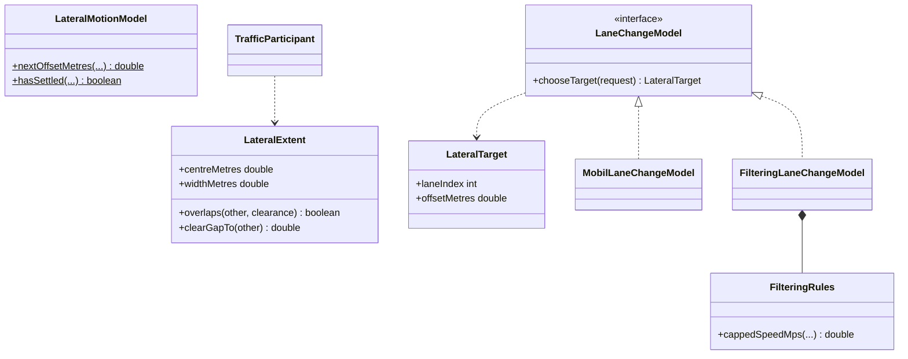
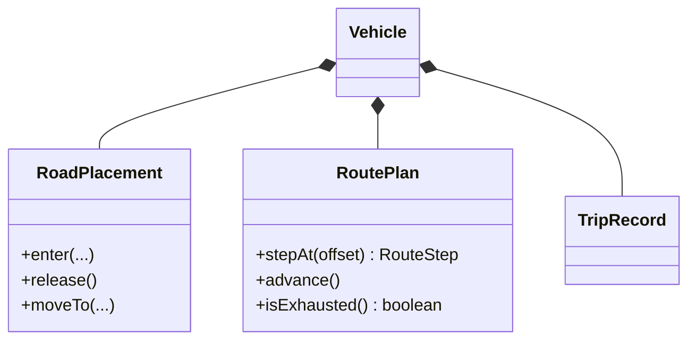
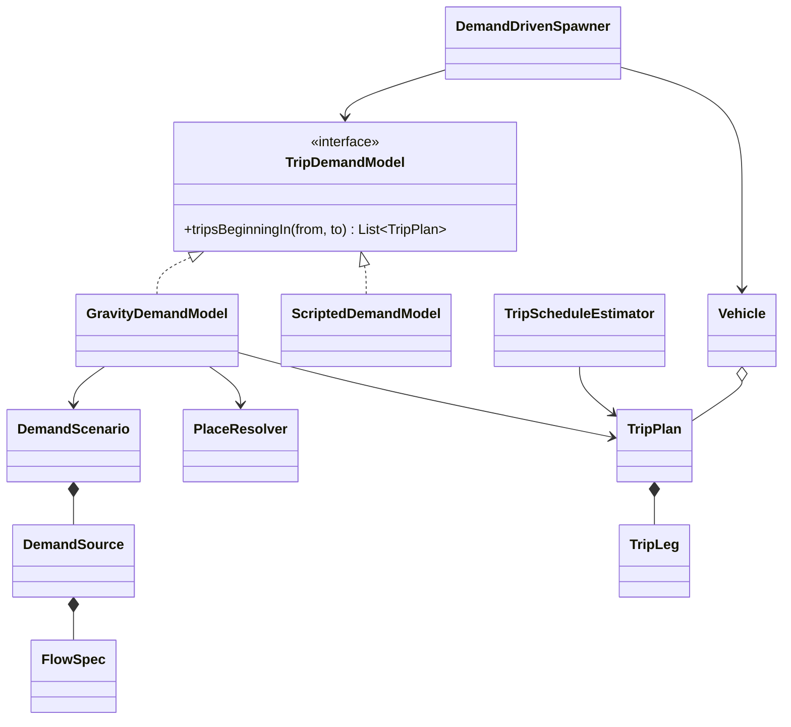
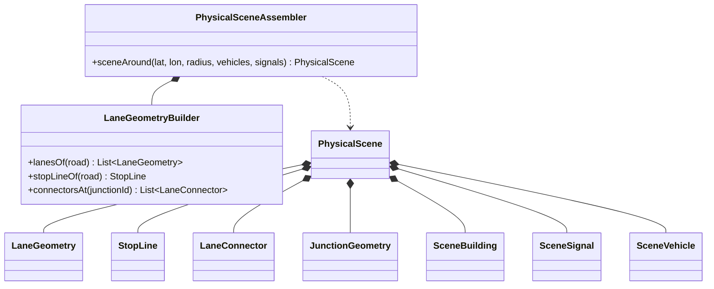

# Implemented Class Diagram

The diagram focuses on the runtime domain after the lane, signal, and event
upgrades. API DTOs and persistence data carriers are omitted for readability.

```mermaid
classDiagram
    class RoadNetwork {
        +getRoad(id) Road
        +findIncomingRoads(id) List~Road~
        +findRoadsByPhysicalRoadId(id) List~Road~
    }
    class Road {
        -String id
        -String name
        -String physicalRoadId
        -int laneCount
        -double laneWidthMetres
        -RoadClass roadClass
        -List~GeoPoint~ geometry
        +getRoadWidthMetres() double
    }
    RoadNetwork "1" *-- "many" Road

    class RoadLayout {
        <<interface>>
        +laneCountOf(Road) int
        +laneWidthMetresOf(Road) double
    }
    class RoadDataRoadLayout
    class RoadClassRoadLayout
    RoadLayout <|.. RoadDataRoadLayout
    RoadLayout <|.. RoadClassRoadLayout

    class Vehicle {
        <<abstract>>
        -int laneIndex
        -double roadProgress
        -VehicleStatus status
        -JourneyPhase accessLinkPhase
        -double accessLinkTravelledMetres
        +planMovement(...) Optional~MovementPlan~
        +commitMovement(...)
        +planJunctionApproach(...) Optional~JunctionApproach~
        +assignTripPlan(TripPlan)
        +advanceBuildingAccessLink(...)
        +getJourneyPhase() JourneyPhase
        +stop()
        +resumeFromStop()
    }
    class JourneyPhase
    class Car
    class Motorcycle
    class Bus {
        -int passengerCapacity
        -List~BusStop~ stops
    }
    class EmergencyVehicle
    Vehicle <|-- Car
    Vehicle <|-- Motorcycle
    Vehicle <|-- Bus
    Vehicle <|-- EmergencyVehicle
    Vehicle --> JourneyPhase

    class TrafficState {
        +occupancyOf(roadId) RoadOccupancy
        +requestCrossing(JunctionApproach)
        +resolveJunctions()
    }
    class RoadOccupancy {
        +lane(index) Lane
        +bestLaneForEntry(vehicle) int
    }
    class Lane {
        +findLeaderFor(vehicle) LeaderGap
        +canAdmit(vehicle) boolean
    }
    class LaneChangeModel {
        <<interface>>
        +chooseTargetLane(request) int
    }
    class MobilLaneChangeModel
    class MotorcycleLaneChangeModel
    class CarFollowingModel {
        <<interface>>
        +nextSpeedMps(context) double
    }
    class KraussCarFollowingModel
    TrafficState --> RoadOccupancy
    RoadOccupancy "1" *-- "many" Lane
    LaneChangeModel <|.. MobilLaneChangeModel
    LaneChangeModel <|.. MotorcycleLaneChangeModel
    Motorcycle --> MotorcycleLaneChangeModel
    CarFollowingModel <|.. KraussCarFollowingModel
    Vehicle --> LaneChangeModel
    Vehicle --> CarFollowingModel

    class TrafficEvent {
        <<abstract>>
        -double startTimeSeconds
        -double durationSeconds
        -double positionAlongRoad
        -Set~Integer~ blockedLaneIndexes
        +apply(RoadNetwork)
        +resolve(RoadNetwork)
    }
    class CongestionEvent
    class AccidentEvent {
        -String causingVehicleId
        -Set~String~ involvedVehicleIds
    }
    class BreakdownEvent {
        -String affectedVehicleId
    }
    class RoadClosureEvent
    class TrafficEventCoordinator
    TrafficEvent <|-- CongestionEvent
    TrafficEvent <|-- AccidentEvent
    TrafficEvent <|-- BreakdownEvent
    TrafficEvent <|-- RoadClosureEvent
    TrafficEventCoordinator --> TrafficEvent

    class TrafficSignal {
        -String junctionId
        -List~SignalPhase~ phases
        +isGreenFor(roadId, elapsedSeconds) boolean
    }
    class SignalPhase {
        +Set~String~ greenIncomingRoadIds
        +double durationSeconds
    }
    class SignalPlan
    TrafficSignal "1" *-- "many" SignalPhase
    SignalPlan --> TrafficSignal

    class VehicleDynamicsEngine {
        +step(...) TrafficState
    }
    class CollisionDetector
    class TickProcessor
    class TrafficSimulator
    class FlowRecorder
    class VehicleTraceStore
    TrafficSimulator *-- TickProcessor
    TickProcessor *-- VehicleDynamicsEngine
    TickProcessor *-- CollisionDetector
    TrafficSimulator *-- FlowRecorder
    TrafficSimulator *-- VehicleTraceStore
    TrafficSimulator o-- TrafficSignal
```

`TrafficLightDelayEvent` and `TrafficLightWait` were removed. Signals now belong
to junctions, repeat by phase, and participate in stop-line arbitration. Event
time is expressed in seconds; integer ticks remain only as deterministic trace
indexes.

## Added since this diagram was drawn

Lateral movement and sub-lane filtering, in `domain/vehicle/dynamics`:

`Vehicle` state, extracted so values that are only meaningful together live
together:

Demand generation and the resolved multi-leg runtime boundary:

`FlowSpec.purpose` is an open `PurposeId`, while destination selectors are
resolved once into concrete places before a vehicle is spawned. The spawner is
therefore independent of whether plans came from building gravity, a scripted
list or a future OD matrix. `TripScheduleEstimator` is a read-only directed
free-flow projection for the schedule API; runtime arrival remains owned by
`Vehicle` and `TickProcessor`.

Scene geometry, in `domain/scene`, derived from the network for the physical
view and never stored:

`domain/scene` sits beside `domain/network` and `domain/vehicle` rather than
under either: it consumes `RoadLayout` and `PolylineGeometry` from
`domain/vehicle` while reading the network, and a package under `network`
reaching up into `vehicle` would invert the layering.

`SimulationClock` gained a time of day, so a demand model can ask what hour it
is. The clock time is derived from elapsed seconds and a published start offset,
never stored per frame.
