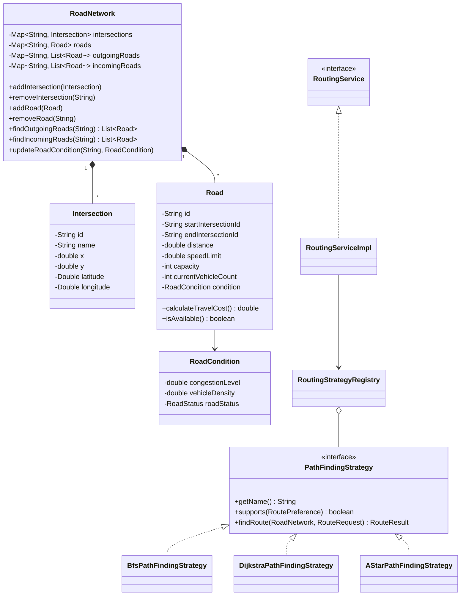
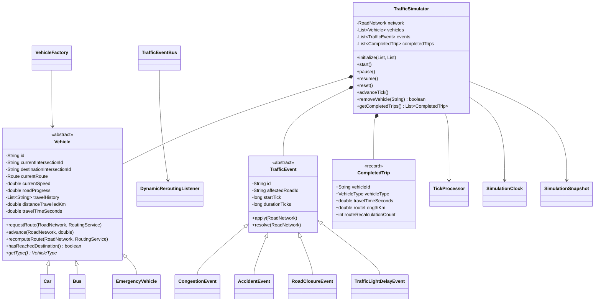
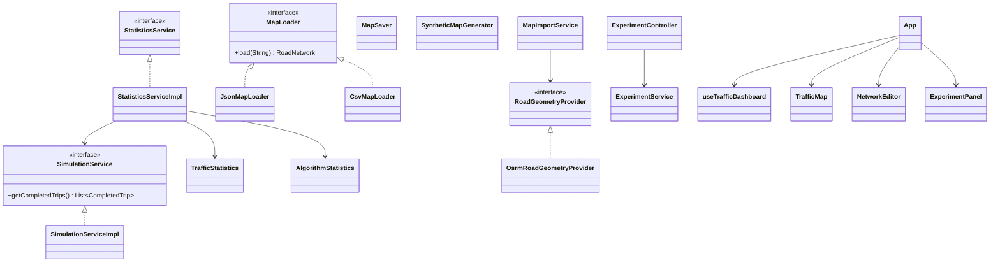

# Class Diagram

The diagrams below show the implemented runtime classes at the level needed to
explain the OOP design. DTO getters and minor helper methods are omitted.

## Network and routing

## Vehicles, simulation, and events

## Services, persistence, and presentation

The backend follows Strategy, Observer, and Factory patterns. The complete
layer responsibilities and runtime data flow are documented in
[ARCHITECTURE.md](ARCHITECTURE.md).
