# Final Class Diagram

This document contains the complete class diagram for the Traffic Event System project.

## Class Diagram

```mermaid
classDiagram
    direction LR

    class RoadNetwork {
        -Map~String, Intersection~ intersections
        -Map~String, Road~ roads
        +addIntersection(Intersection)
        +removeIntersection(String)
        +addRoad(Road)
        +removeRoad(String)
        +findOutgoingRoads(String) List~Road~
        +findIncomingRoads(String) List~Road~
        +updateRoadCondition(String, RoadCondition)
    }

    class Intersection {
        -String id
        -String name
        -double x
        -double y
        -LocationType locationType
    }

    class Road {
        -String id
        -String startIntersectionId
        -String endIntersectionId
        -double distance
        -double speedLimit
        -int capacity
        -int currentVehicleCount
        -RoadCondition condition
        +calculateTravelCost() double
        +isAvailable() boolean
    }

    class RoadCondition {
        -double congestionLevel
        -double vehicleDensity
        -RoadStatus status
        +increaseCongestion(double)
        +markBlocked()
        +markOpen()
    }

    class RoadStatus {
        <<enumeration>>
        OPEN
        CONGESTED
        BLOCKED
        CLOSED
    }

    class LocationType {
        <<enumeration>>
        SCHOOL
        HOSPITAL
        BAR
        RESIDENTIAL
        COMMERCIAL
        NORMAL
    }

    RoadNetwork "1" *-- "*" Intersection
    RoadNetwork "1" *-- "*" Road
    Road --> RoadCondition
    RoadCondition --> RoadStatus
    Intersection --> LocationType

    class Vehicle {
        <<abstract>>
        -String id
        -String currentIntersectionId
        -String destinationIntersectionId
        -Route currentRoute
        -double movementSpeed
        -double length
        -double width
        -double maxSpeed
        -double currentSpeed
        -double acceleration
        -double deceleration
        -double vehicleWeight
        -int priorityLevel
        -VehicleStatus status
        -List~String~ travelHistory
        +getType()* VehicleType
        +requestRoute(RoutingService)
        +moveOneStep()
        +recomputeRoute(RoutingService)
        +hasReachedDestination() boolean
        +accelerate(double)
        +decelerate(double)
    }

    class Car {
        +getType() VehicleType
    }

    class Bus {
        -int passengerCapacity
        +getType() VehicleType
    }

    class EmergencyVehicle {
        -int priorityLevel
        +getType() VehicleType
    }

    class VehicleFactory {
        +createVehicle(VehicleType, String, String) Vehicle
        +createCar(String, String) Car
        +createBus(String, String) Bus
        +createEmergencyVehicle(String, String) EmergencyVehicle
    }

    class VehicleType {
        <<enumeration>>
        CAR
        BUS
        EMERGENCY
    }

    class VehicleStatus {
        <<enumeration>>
        WAITING
        MOVING
        ARRIVED
        BLOCKED
    }

    Vehicle <|-- Car
    Vehicle <|-- Bus
    Vehicle <|-- EmergencyVehicle
    Vehicle --> Route
    Vehicle --> VehicleStatus
    Vehicle --> VehicleType
    VehicleFactory --> Vehicle

    class Route {
        -List~RouteStep~ steps
        -double totalDistance
        -double estimatedTravelTime
        -double totalCost
    }

    class RouteStep {
        -String fromIntersectionId
        -String toIntersectionId
        -String roadId
        -double cost
    }

    class RouteRequest {
        -String startIntersectionId
        -String destinationIntersectionId
        -RoutePreference preference
    }

    class RouteResult {
        -Route route
        -String algorithmName
        -long computationTimeMillis
        -int visitedNodes
    }

    class RoutePreference {
        <<enumeration>>
        SHORTEST_DISTANCE
        SHORTEST_TIME
        CONGESTION_AWARE
    }

    Route "1" *-- "*" RouteStep
    RouteRequest --> RoutePreference
    RouteResult --> Route

    class PathFindingStrategy {
        <<interface>>
        +getName() String
        +supports(RoutePreference) boolean
        +findRoute(RoadNetwork, RouteRequest) RouteResult
    }

    class BfsPathFindingStrategy
    class DijkstraPathFindingStrategy
    class AStarPathFindingStrategy

    class Heuristic {
        <<interface>>
        +estimate(Intersection, Intersection) double
    }

    class RoutingStrategyRegistry {
        -List~PathFindingStrategy~ strategies
        +register(PathFindingStrategy)
        +findByName(String) PathFindingStrategy
        +findForPreference(RoutePreference) PathFindingStrategy
    }

    PathFindingStrategy <|.. BfsPathFindingStrategy
    PathFindingStrategy <|.. DijkstraPathFindingStrategy
    PathFindingStrategy <|.. AStarPathFindingStrategy
    AStarPathFindingStrategy --> Heuristic
    RoutingStrategyRegistry "1" *-- "*" PathFindingStrategy

    class TrafficEvent {
        <<abstract>>
        -String id
        -String affectedRoadId
        -long startTick
        -long durationTicks
        -TrafficEventStatus status
        +getType()* TrafficEventType
        +apply(RoadNetwork)
        +resolve(RoadNetwork)
        +isActive(long) boolean
    }

    class CongestionEvent {
        -double congestionIncrease
    }

    class AccidentEvent {
        -double capacityReduction
        -String causingVehicleId
    }

    class RoadClosureEvent

    class TrafficLightDelayEvent {
        -long delayTicks
    }

    class TrafficEventType {
        <<enumeration>>
        CONGESTION
        ACCIDENT
        ROAD_CLOSURE
        TRAFFIC_LIGHT_DELAY
    }

    class TrafficEventStatus {
        <<enumeration>>
        SCHEDULED
        ACTIVE
        RESOLVED
    }

    TrafficEvent <|-- CongestionEvent
    TrafficEvent <|-- AccidentEvent
    TrafficEvent <|-- RoadClosureEvent
    TrafficEvent <|-- TrafficLightDelayEvent
    TrafficEvent --> TrafficEventType
    TrafficEvent --> TrafficEventStatus

    class TrafficEventListener {
        <<interface>>
        +onTrafficEvent(TrafficEvent)
    }

    class TrafficEventBus {
        -List~TrafficEventListener~ listeners
        +subscribe(TrafficEventListener)
        +unsubscribe(TrafficEventListener)
        +publish(TrafficEvent)
    }

    TrafficEventBus --> TrafficEventListener
    TrafficEventBus --> TrafficEvent

    class TrafficSimulator {
        -RoadNetwork roadNetwork
        -List~Vehicle~ vehicles
        -List~TrafficEvent~ events
        -SimulationClock clock
        -SimulationStatus status
        +start()
        +pause()
        +resume()
        +reset()
        +advanceOneTick()
        +createSnapshot() SimulationSnapshot
    }

    class TickProcessor {
        +processTick(TrafficSimulator)
        +moveVehicles()
        +processEvents()
        +updateCongestion()
    }

    class SimulationClock {
        -long currentTick
        +tick()
        +reset()
        +getCurrentTick() long
    }

    class SimulationSnapshot {
        -long tick
        -SimulationStatus status
        -List~Vehicle~ vehicles
        -RoadNetwork roadNetwork
        -TrafficStatistics statistics
    }

    class SimulationStatus {
        <<enumeration>>
        READY
        RUNNING
        PAUSED
        FINISHED
    }

    TrafficSimulator --> RoadNetwork
    TrafficSimulator --> Vehicle
    TrafficSimulator --> TrafficEvent
    TrafficSimulator --> SimulationClock
    TrafficSimulator --> SimulationSnapshot
    TrafficSimulator --> SimulationStatus
    TickProcessor --> TrafficSimulator

    class TrafficStatistics {
        -int totalVehicles
        -int arrivedVehicles
        -double averageTravelTime
        -double averageCongestionLevel
        -int blockedRoadCount
    }

    class AlgorithmStatistics {
        -String algorithmName
        -long averageComputationTime
        -int routeRecalculationCount
        -double averageRouteCost
        -int successfulRoutes
        -int failedRoutes
    }

    SimulationSnapshot --> TrafficStatistics

    class RoadNetworkService {
        <<interface>>
    }

    class RoutingService {
        <<interface>>
    }

    class VehicleService {
        <<interface>>
    }

    class TrafficEventService {
        <<interface>>
    }

    class SimulationService {
        <<interface>>
    }

    class StatisticsService {
        <<interface>>
    }

    class RoadNetworkServiceImpl
    class RoutingServiceImpl
    class VehicleServiceImpl
    class TrafficEventServiceImpl
    class SimulationServiceImpl
    class StatisticsServiceImpl

    RoadNetworkService <|.. RoadNetworkServiceImpl
    RoutingService <|.. RoutingServiceImpl
    VehicleService <|.. VehicleServiceImpl
    TrafficEventService <|.. TrafficEventServiceImpl
    SimulationService <|.. SimulationServiceImpl
    StatisticsService <|.. StatisticsServiceImpl

    RoutingServiceImpl --> RoutingStrategyRegistry
    VehicleServiceImpl --> VehicleFactory
    TrafficEventServiceImpl --> TrafficEventBus
    SimulationServiceImpl --> TrafficSimulator
    StatisticsServiceImpl --> TrafficStatistics
    StatisticsServiceImpl --> AlgorithmStatistics

    class MapLoader {
        <<interface>>
        +load(String) RoadNetwork
    }

    class CsvMapLoader
    class JsonMapLoader
    class MapSaver
    class SyntheticMapGenerator {
        +generateGridMap(int, int) RoadNetwork
    }

    MapLoader <|.. CsvMapLoader
    MapLoader <|.. JsonMapLoader
    CsvMapLoader --> RoadNetwork
    JsonMapLoader --> RoadNetwork
    SyntheticMapGenerator --> RoadNetwork
```

## Design Patterns

| Pattern | Classes |
|---|---|
| Strategy Pattern | `PathFindingStrategy`, `BfsPathFindingStrategy`, `DijkstraPathFindingStrategy`, `AStarPathFindingStrategy` |
| Factory Pattern | `VehicleFactory`, `Car`, `Bus`, `EmergencyVehicle` |
| Observer Pattern | `TrafficEventBus`, `TrafficEventListener`, `TrafficEvent` |
| MVC-like Separation | React components, API controllers, services, domain models |
