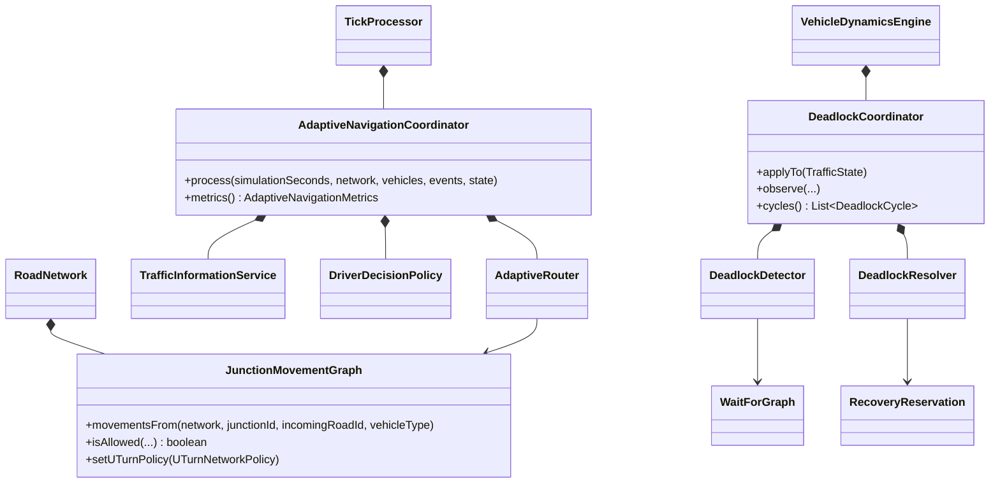
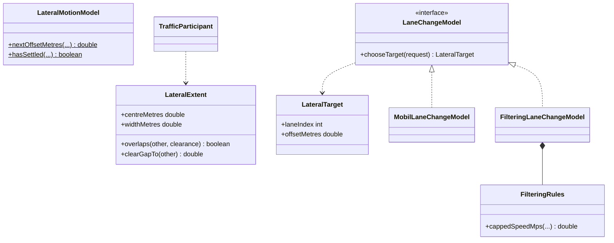
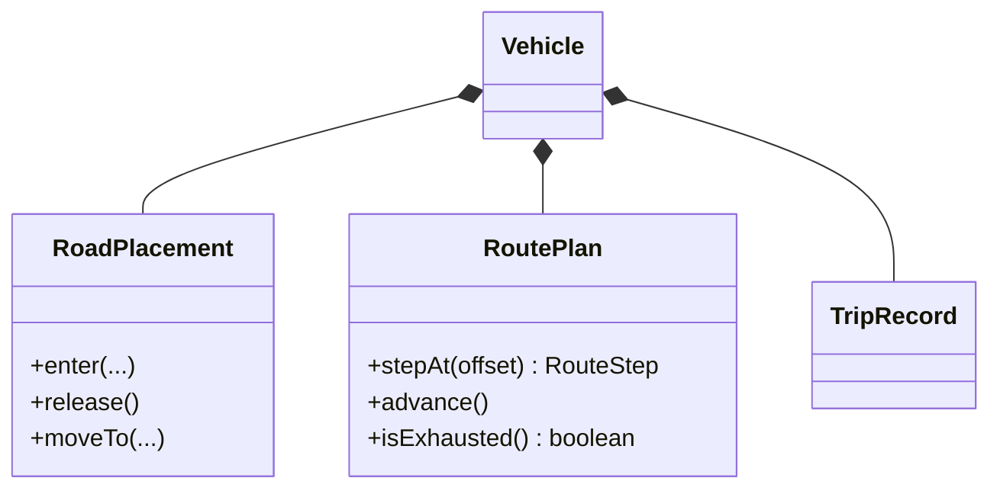
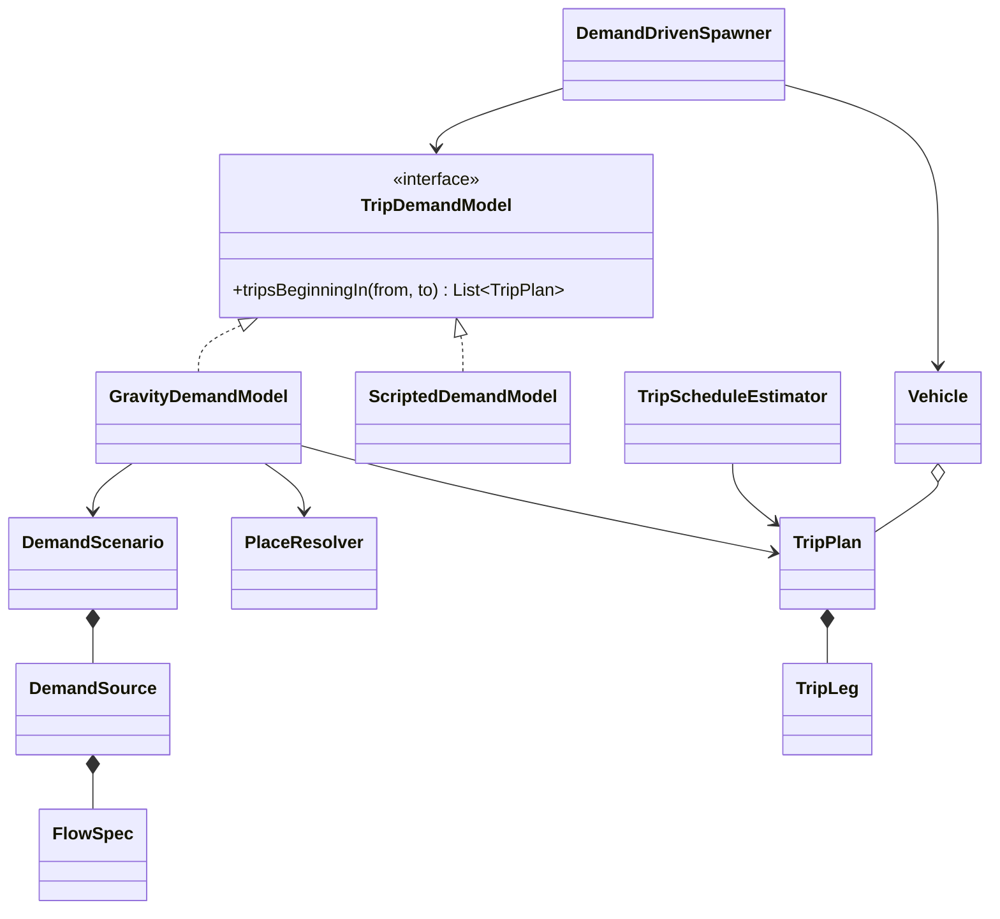
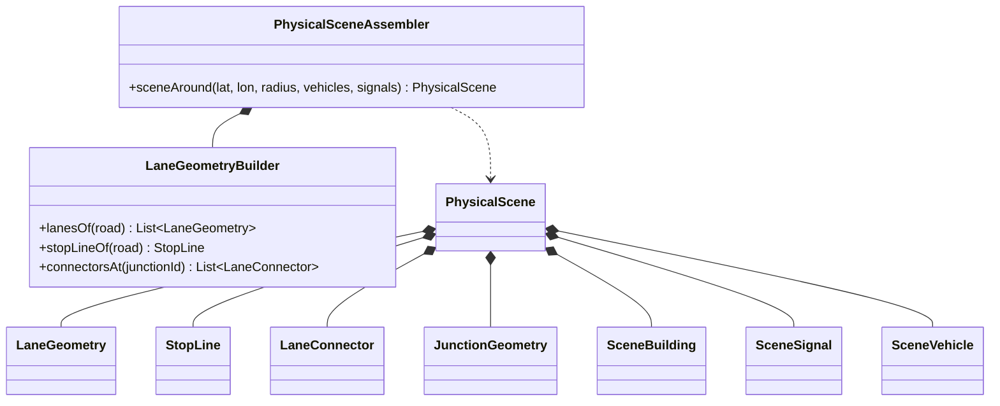

# Implemented Class Diagram

This document is a set of deliberate views, not one exhaustive drawing. The
current `src/main/java` tree has 285 top-level Java types (135 classes, 23
interfaces, 32 enums and 95 records); a single diagram of all of them would be
unreadable and would hide the design instead of showing it. Each view below
answers one question.

| View | Question it answers |
|---|---|
| [Object-oriented design](#object-oriented-design) | Where are the OOP principles and design patterns? |
| [Runtime domain](#runtime-domain) | What owns state while the simulation runs? |
| [Adaptive navigation and deadlock](#view-adaptive-navigation-u-turns-and-deadlock) | How are legal reroutes, U-turns and physical deadlock recovery coordinated? |
| [Lateral movement](#view-lateral-movement-and-sub-lane-filtering) | How does a vehicle move across the road? |
| [Vehicle state](#view-vehicle-state) | What does a vehicle carry, and why is it split up? |
| [Demand](#view-demand-generation-and-the-multi-leg-runtime) | Where do vehicles come from? |
| [Scene geometry](#view-scene-geometry) | How is lane-level geometry derived for rendering? |

## Object-oriented design

This view carries the requirements in specification §5 (OOP), §7 (suggested
architecture) and §8 (design patterns). Physical detail is deliberately left
out; the other views cover it.

```mermaid
classDiagram
    class PathFindingStrategy {
        <<interface>>
        +getName() String
        +supports(RoutePreference) boolean
        +findRoute(RoadNetwork, RouteRequest) RouteResult
    }
    class BfsPathFindingStrategy
    class DijkstraPathFindingStrategy
    class AStarPathFindingStrategy
    class RoutingStrategyRegistry {
        +register(PathFindingStrategy)
        +findForPreference(RoutePreference) Optional~PathFindingStrategy~
        +findByName(String) Optional~PathFindingStrategy~
        +getAll() List~PathFindingStrategy~
    }
    PathFindingStrategy <|.. BfsPathFindingStrategy
    PathFindingStrategy <|.. DijkstraPathFindingStrategy
    PathFindingStrategy <|.. AStarPathFindingStrategy
    RoutingStrategyRegistry o-- PathFindingStrategy

    class RoutingService {
        <<interface>>
        +findRoute(RoadNetwork, RouteRequest) RouteResult
        +getStrategies() List~PathFindingStrategy~
        +getAlgorithmStatistics() List~AlgorithmStatistics~
        +findRouteBetweenBuildings(RoadNetwork, String, String, RoutePreference) BuildingRoutePlan
    }
    class RoutingServiceImpl
    RoutingService <|.. RoutingServiceImpl
    RoutingServiceImpl --> RoutingStrategyRegistry

    class RoadNetworkService {
        <<interface>>
    }
    class SimulationService {
        <<interface>>
    }
    class VehicleService {
        <<interface>>
    }
    class TrafficEventService {
        <<interface>>
    }
    class StatisticsService {
        <<interface>>
    }
    class RoutingController
    class SimulationController
    RoutingController --> RoutingService
    SimulationController --> SimulationService

    class TrafficEventBus {
        +subscribe(TrafficEventListener)
        +unsubscribe(TrafficEventListener)
        +publish(TrafficEvent)
    }
    class TrafficEventListener {
        <<interface>>
        +onTrafficEvent(TrafficEvent)
    }
    class DynamicReroutingListener
    <<legacy extension>> DynamicReroutingListener
    TrafficEventBus o-- TrafficEventListener
    TrafficEventListener <|.. DynamicReroutingListener

    class VehicleFactory {
        +createVehicle(VehicleType, String, String) Vehicle
        +configureVehicle(T) T
    }
    class Vehicle {
        <<abstract>>
    }
    VehicleFactory ..> Vehicle

    class MapLoader {
        <<interface>>
        +load(String) RoadNetwork
    }
    class JsonMapLoader
    class CsvMapLoader
    class SyntheticMapGenerator
    MapLoader <|.. JsonMapLoader
    MapLoader <|.. CsvMapLoader
```

| Requirement | Pattern | Where |
|---|---|---|
| §5 Inheritance — routing algorithms inherit from abstract interfaces | — | `PathFindingStrategy` and its three implementations |
| §5 Polymorphism — algorithms switched dynamically | Strategy | `RoutingStrategyRegistry.findForPreference(RoutePreference)` |
| §5 Abstraction — components interact through abstract APIs | — | Core use-case controllers use `service/` interfaces; focused scenario/import, experiment and scene controllers also use concrete collaborators |
| §5 Encapsulation — objects manage their own state | — | `Road`, `VehicleProfile`, `TrafficEvent` validate in their constructors |
| §8 Strategy — routing algorithms | Strategy | `PathFindingStrategy`; also `CarFollowingModel`, `LaneChangeModel`, `TripDemandModel`, `RoadLayout` |
| §8 Observer — traffic updates | Observer | `TrafficEventBus` / `TrafficEventListener` |
| §8 Factory — vehicle generation | Factory | `VehicleFactory` |
| §8 MVC — GUI separation | MVC-like | React view, Javalin controllers, services, domain model |

`DynamicReroutingListener` is the Observer extension point. Production adaptive
rerouting is coordinated by `AdaptiveNavigationCoordinator` instead, which adds
driver information access, latency, cooldowns and stall state; the event bus
still publishes every event transition.

The Singleton pattern is deliberately not used. Dependencies are injected
through constructors at one composition root (`App`), which keeps every class
constructible in a test without global state. The specification asks for at
least two patterns; four are implemented.

### Specification names and implemented names

Specification §6 and §7 suggest names that this implementation renamed as the
design became more specific. The mapping is:

| Specification | Implemented as | Note |
|---|---|---|
| `Graph` | `RoadNetwork` | Directed graph aggregate; a `Road` is one direction of travel |
| `Road`, `Intersection` | `Road`, `Intersection` | unchanged |
| `Vehicle`, `Car`, `Bus`, `EmergencyVehicle` | same | plus `Motorcycle`, the optional two-wheeler |
| `PathFindingStrategy` | same | unchanged |
| `DijkstraStrategy`, `AStarStrategy` | `DijkstraPathFindingStrategy`, `AStarPathFindingStrategy` | plus `BfsPathFindingStrategy` |
| `TrafficSimulator`, `TrafficEvent` | same | unchanged |
| `TrafficController` | `TrafficSignal` + `SignalPlan` + `JunctionController` | split by responsibility: signal state, plan generation, and per-step arbitration |
| `StatisticsManager` | `StatisticsService` / `StatisticsServiceImpl` | named as a service for consistency with the other seven |
| `MapLoader` | `MapLoader` interface + `JsonMapLoader`, `CsvMapLoader` | unchanged |
| `VisualizationEngine` | React frontend + `PhysicalSceneAssembler` | rendering runs in the browser; the backend derives scene geometry only |
| simulation / algorithm / visualization / utility layers | `simulation/` / `routing/` / `frontend/` / `persistence/` + `service/` | same four responsibilities |

Specification §4.4 lists *Traffic Light Delay* among the possible events.
Signals are implemented instead as `TrafficSignal`, a junction-owned cyclic
controller that participates in stop-line arbitration, so vehicles do wait at
intersections as required. It is not modelled as a `TrafficEvent` because a
signal is repeating infrastructure rather than a one-off incident on one road,
and because it must interact with right-of-way. `BreakdownEvent` was added as a
fourth event type in its place. See [Runtime domain](#runtime-domain).

## Runtime domain

This view focuses on the runtime domain after the lane, signal, and event
upgrades. API DTOs and persistence data carriers are omitted for readability.

```mermaid
classDiagram
    class RoadNetwork {
        +getRoad(id) Road
        +findIncomingRoads(id) List~Road~
        +findRoadsByPhysicalRoadId(id) List~Road~
    }
    class Road {
        -String id
        -String name
        -String physicalRoadId
        -int laneCount
        -double laneWidthMetres
        -RoadClass roadClass
        -List~GeoPoint~ geometry
        +getRoadWidthMetres() double
    }
    RoadNetwork "1" *-- "many" Road

    class RoadLayout {
        <<interface>>
        +laneCountOf(Road) int
        +laneWidthMetresOf(Road) double
    }
    class RoadDataRoadLayout
    class RoadClassRoadLayout
    RoadLayout <|.. RoadDataRoadLayout
    RoadLayout <|.. RoadClassRoadLayout

    class Vehicle {
        <<abstract>>
        -int laneIndex
        -double roadProgress
        -VehicleStatus status
        -JourneyPhase accessLinkPhase
        -double accessLinkTravelledMetres
        +planMovement(...) Optional~MovementPlan~
        +commitMovement(...)
        +planJunctionApproach(...) Optional~JunctionApproach~
        +assignTripPlan(TripPlan)
        +advanceBuildingAccessLink(...)
        +getJourneyPhase() JourneyPhase
        +stop()
        +resumeFromStop()
    }
    class JourneyPhase
    class Car
    class Motorcycle
    class Bus {
        -int passengerCapacity
        -List~BusStop~ stops
    }
    class EmergencyVehicle
    class VehicleProfile {
        <<record>>
        +lengthMetres double
        +widthMetres double
        +maxSpeedKph double
        +priorityLevel int
    }
    class DriverProfile {
        <<record>>
        +minimumGapMetres double
        +reactionTimeSeconds double
        +imperfection double
        +politeness double
        +maxLateralSpeedMps double
    }
    Vehicle <|-- Car
    Vehicle <|-- Motorcycle
    Vehicle <|-- Bus
    Vehicle <|-- EmergencyVehicle
    Vehicle --> JourneyPhase
    Vehicle *-- VehicleProfile
    Vehicle *-- DriverProfile

    class TrafficState {
        +occupancyOf(roadId) RoadOccupancy
        +requestCrossing(JunctionApproach)
        +resolveJunctions()
    }
    class RoadOccupancy {
        +lane(index) Lane
        +bestLaneForEntry(vehicle) int
    }
    class Lane {
        +findLeaderFor(vehicle) LeaderGap
        +canAdmit(vehicle) boolean
    }
    class LaneChangeModel {
        <<interface>>
        +chooseTargetLane(request) int
        +chooseTarget(request) LateralTarget
    }
    class MobilLaneChangeModel
    class FilteringLaneChangeModel
    class CarFollowingModel {
        <<interface>>
        +nextSpeedMps(context) double
    }
    class KraussCarFollowingModel
    TrafficState --> RoadOccupancy
    RoadOccupancy "1" *-- "many" Lane
    LaneChangeModel <|.. MobilLaneChangeModel
    LaneChangeModel <|.. FilteringLaneChangeModel
    Motorcycle --> FilteringLaneChangeModel
    CarFollowingModel <|.. KraussCarFollowingModel
    Vehicle --> LaneChangeModel
    Vehicle --> CarFollowingModel

    class TrafficEvent {
        <<abstract>>
        -double startTimeSeconds
        -double durationSeconds
        -double positionAlongRoad
        -Set~Integer~ blockedLaneIndexes
        +apply(RoadNetwork)
        +resolve(RoadNetwork)
    }
    class CongestionEvent
    class AccidentEvent {
        -String causingVehicleId
        -Set~String~ involvedVehicleIds
    }
    class BreakdownEvent {
        -String affectedVehicleId
    }
    class RoadClosureEvent
    class TrafficEventCoordinator
    TrafficEvent <|-- CongestionEvent
    TrafficEvent <|-- AccidentEvent
    TrafficEvent <|-- BreakdownEvent
    TrafficEvent <|-- RoadClosureEvent
    TrafficEventCoordinator --> TrafficEvent

    class TrafficSignal {
        -String junctionId
        -List~SignalPhase~ phases
        +isGreenFor(roadId, elapsedSeconds) boolean
    }
    class SignalPhase {
        +Set~String~ greenIncomingRoadIds
        +double durationSeconds
    }
    class SignalPlan
    TrafficSignal "1" *-- "many" SignalPhase
    SignalPlan --> TrafficSignal

    class VehicleDynamicsEngine {
        +step(...) TrafficState
    }
    class CollisionDetector
    class TickProcessor
    class TrafficSimulator
    class FlowRecorder
    class VehicleTraceStore
    TrafficSimulator *-- TickProcessor
    TickProcessor *-- VehicleDynamicsEngine
    TickProcessor *-- CollisionDetector
    TrafficSimulator *-- FlowRecorder
    TrafficSimulator *-- VehicleTraceStore
    TrafficSimulator o-- TrafficSignal
```



`TrafficLightDelayEvent` and `TrafficLightWait` were removed. Signals now belong
to junctions, repeat by phase, and participate in stop-line arbitration. Event
time is expressed in seconds; integer ticks remain only as deterministic trace
indexes.

`VehicleProfile` describes the machine and is fixed for the life of the
vehicle. `DriverProfile` describes the person: its motion fields are varied
deterministically from the vehicle id, while its nested `DriverDecisionProfile`
is varied from both the vehicle id and the scenario seed. They are separate
because they change for different reasons: one is a vehicle model, the other is
a behaviour calibration.

## View: adaptive navigation, U-turns, and deadlock

This view shows the production control path. The Observer bus remains available
to extensions, but it is not the route-mutation mechanism.



`JunctionMovementGraph` makes `(incoming road, junction)` part of route state and
applies vehicle-type-specific U-turn policy. `AdaptiveNavigationCoordinator`
delivers imperfect information and atomically splices a legal suffix without
moving the vehicle. `DeadlockCoordinator` confirms persistent wait-for cycles,
gates new entrants and reserves one real drain path; strict recovery has no
teleport/despawn branch.

## View: lateral movement and sub-lane filtering

In `domain/vehicle/dynamics`. This is what lets a narrow vehicle ride between
two lanes instead of queueing in one:



## View: vehicle state

Extracted from `Vehicle` so that values which are only meaningful together live
together, and are acquired and discarded as one act:



## View: demand generation and the multi-leg runtime

Where vehicles come from, and how one plan becomes several legs:



`FlowSpec.purpose` is an open `PurposeId`, while destination selectors are
resolved once into concrete places before a vehicle is spawned. The spawner is
therefore independent of whether plans came from building gravity, a scripted
list or a future OD matrix. `TripScheduleEstimator` is a read-only directed
free-flow projection for the schedule API; runtime arrival remains owned by
`Vehicle` and `TickProcessor`.

## View: scene geometry

In `domain/scene`, derived from the network for the physical view and never
stored:



`domain/scene` sits beside `domain/network` and `domain/vehicle` rather than
under either: it consumes `RoadLayout` and `PolylineGeometry` from
`domain/vehicle` while reading the network, and a package under `network`
reaching up into `vehicle` would invert the layering.

`SimulationClock` gained a time of day, so a demand model can ask what hour it
is. The clock time is derived from elapsed seconds and a published start offset,
never stored per frame.
