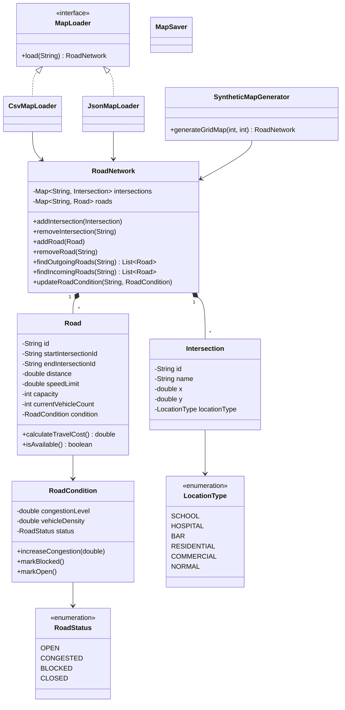

# Binh: Road Network and Persistence

This document contains Binh's part of the first documentation commit.
Binh is responsible for the road network model, road condition model, map loading, map saving, and synthetic map generation.

## Folder Structure

```text
src/main/java/team/traffic/domain/network/
|-- RoadNetwork.java
|-- Intersection.java
|-- Road.java
|-- RoadCondition.java
|-- RoadStatus.java
`-- LocationType.java

src/main/java/team/traffic/persistence/
|-- MapLoader.java
|-- CsvMapLoader.java
|-- JsonMapLoader.java
|-- MapSaver.java
`-- SyntheticMapGenerator.java

data/
|-- sample_map.csv
|-- sample_map.json
|-- small_city.json
|-- congestion_demo.json
`-- accident_demo.json
```

## Responsibilities

| Class | Responsibility |
|---|---|
| `RoadNetwork` | Stores the graph of intersections and roads, and provides graph operations. |
| `Intersection` | Represents a point in the city map. |
| `Road` | Represents a directed connection between two intersections. |
| `RoadCondition` | Stores congestion level, vehicle density, and current road status. |
| `RoadStatus` | Enum for road state: open, congested, blocked, or closed. |
| `LocationType` | Enum for realistic places such as school, hospital, bar, residential, and commercial areas. |
| `MapLoader` | Interface for loading a road network from a file. |
| `CsvMapLoader` | Loads road network data from CSV files. |
| `JsonMapLoader` | Loads road network data from JSON files. |
| `MapSaver` | Saves the current road network to a file. |
| `SyntheticMapGenerator` | Generates automatic demo maps for simulation and testing. |

## Class Diagram



