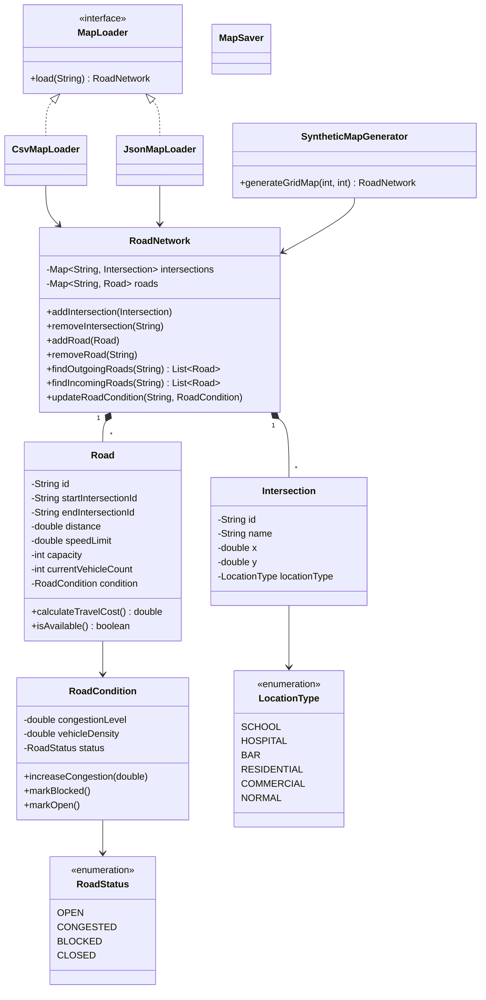

# Binh: Road Network and Persistence

This document contains Binh's part of the first documentation commit.
Binh is responsible for the road network model, road condition model, map loading, map saving, and synthetic map generation.

## Folder Structure

```text
src/main/java/team/traffic/domain/network/
|-- RoadNetwork.java
|-- Intersection.java
|-- Road.java
|-- RoadCondition.java
|-- RoadStatus.java
`-- LocationType.java

src/main/java/team/traffic/persistence/
|-- MapLoader.java
|-- CsvMapLoader.java
|-- JsonMapLoader.java
|-- MapSaver.java
`-- SyntheticMapGenerator.java

data/
|-- sample_map.csv
|-- sample_map.json
|-- small_city.json
|-- congestion_demo.json
`-- accident_demo.json
```

## Responsibilities

| Class | Responsibility |
|---|---|
| `RoadNetwork` | Stores the graph of intersections and roads, and provides graph operations. |
| `Intersection` | Represents a point in the city map. |
| `Road` | Represents a directed connection between two intersections. |
| `RoadCondition` | Stores congestion level, vehicle density, and current road status. |
| `RoadStatus` | Enum for road state: open, congested, blocked, or closed. |
| `LocationType` | Enum for realistic places such as school, hospital, bar, residential, and commercial areas. |
| `MapLoader` | Interface for loading a road network from a file. |
| `CsvMapLoader` | Loads road network data from CSV files. |
| `JsonMapLoader` | Loads road network data from JSON files. |
| `MapSaver` | Saves the current road network to a file. |
| `SyntheticMapGenerator` | Generates automatic demo maps for simulation and testing. |

## Road Data and Travel-Cost Contract

The network and routing modules use the following units:

| Field | Unit / range |
|---|---|
| `distance` | kilometres |
| `speedLimit` | kilometres per hour |
| free-flow travel time | hours |
| `congestionLevel` | normalized ratio from `0.0` to `1.0` |
| `vehicleDensity` | normalized ratio from `0.0` to `1.0` |
| routing travel cost | equivalent travel hours |

For a routable road with remaining capacity:

```text
freeFlowTimeHours = distance / speedLimit
conditionMultiplier = 1 + congestionLevel + vehicleDensity
travelCost = freeFlowTimeHours * conditionMultiplier
```

`vehicleDensity` is already the traffic-load input to this formula. The
`currentVehicleCount / capacity` ratio is therefore not multiplied into the
cost again; it is used for capacity checks and traffic statistics. A blocked,
closed, or full road has an infinite routing cost.

## Week 4 Road Density Contract

Student A owns the road-density foundation used by the simulation and routing
layers. The domain model keeps density as a normalized `0.0..1.0` value:

```text
vehicleDensity = currentVehicleCount / capacity
```

Runtime vehicle movement should update density through the road-network
contract instead of mutating fields directly:

```java
network.recordVehicleEnteringRoad("R1");
network.recordVehicleLeavingRoad("R1");
network.updateVehicleDensity("R1");
```

`recordVehicleEnteringRoad` rejects blocked, closed, and full roads. Leaving a
road is allowed only when at least one vehicle is currently recorded on that
road. These methods intentionally do not move `Vehicle` objects, recompute
routes, process ticks, or trigger traffic events; those remain the boundaries
of the vehicle, routing, simulation, and event modules.

Density statistics available to other modules:

- `getAverageVehicleDensity()` returns the mean density across all roads.
- `findRoadsAtOrAboveDensity(minimumDensity)` returns dense roads in insertion
  order for heatmaps, congestion checks, or later simulation rules.

CSV and JSON map loaders also validate density consistency. A road's stored
`vehicleDensity` must match `currentVehicleCount / capacity` within a small
rounding tolerance, so demo maps and saved maps do not drift away from the
runtime density contract.

Consumers that display seconds should convert hours using:

```text
seconds = hours * 3600
```

## Map Validation Rules

Both CSV and JSON loaders enforce the same domain rules:

- a map contains at least one intersection;
- intersection and road IDs are unique;
- every road endpoint references an existing intersection;
- all required numeric, enum, and identity fields are present and valid;
- invalid records are reported as `InvalidMapException` with record or array-index context.

CSV records may appear in any order. The loader reads the complete file and
adds all intersections before adding roads. Unsupported record types and
missing required headers are rejected instead of being ignored.

`MapSaver` creates missing parent directories and sorts intersections and roads
by ID. This produces deterministic JSON files and makes save/load round-trip
tests and Git diffs stable.

## Synthetic and Sample Maps

`SyntheticMapGenerator.generateGridMap(rows, columns)` creates a rectangular
grid with predictable IDs such as `I_0_0`. Every horizontal and vertical
neighbor pair receives two directed roads. Generated roads are 1 km long, use a
50 km/h speed limit, have capacity 100, and start open with zero traffic.

The number of directed roads is:

```text
2 * [rows * (columns - 1) + columns * (rows - 1)]
```

`data/small_city.json` is the Week 3 routing dataset. It contains six
intersections, all supported location types, alternative paths, four congested
roads, and one blocked direct road. `congestion_demo.json` and
`accident_demo.json` remain reserved for the Week 5 event implementation.

`data/density_demo.json` is the Week 4 road-density dataset. It contains four
roads with low, medium, high, and full density levels so the team can demo how
capacity usage changes road availability and congestion-aware cost.

## Class Diagram



