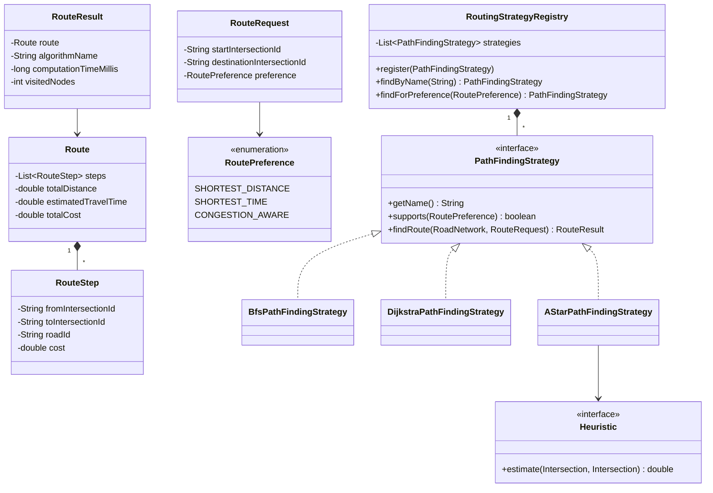

# Routing + Algorithms

This document contains the routing domain model and pathfinding algorithm structure for the Traffic Event System.

## Folder Structure

```text
src/main/java/team/traffic/domain/routing/
├── Route.java
├── RouteStep.java
├── RouteRequest.java
├── RouteResult.java
└── RoutePreference.java

src/main/java/team/traffic/routing/
├── PathFindingStrategy.java
├── BfsPathFindingStrategy.java
├── DijkstraPathFindingStrategy.java
├── AStarPathFindingStrategy.java
├── RoutingStrategyRegistry.java
└── Heuristic.java
```

## Class Diagram


